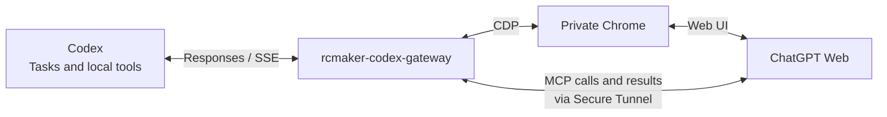

# rcmaker-codex-gateway

**English** · [简体中文](README.zh-CN.md)

Connect ChatGPT Web models to your local Codex development workflow. Keep working in Codex while the gateway delivers context, relays native tool calls and streams the model's public progress and final answer.

**This application is developed on the [RCMAKER PHP framework](https://github.com/runchance/rcmaker).** File changes, commands, browser tools, skills and configured MCP tools execute through the existing Codex runtime, subject to its own permissions and approvals.

## Documentation

| Start here | What you will find |
| --- | --- |
| **[Illustrated user guide](docs/user-guide.en.md)** | Installation, screenshots for every setup step, first task, daily use and upgrades |
| **[Frequently asked questions](docs/faq.en.md)** | Connections, models, context compaction, usage and recovery |

| [Chinese documentation](README.zh-CN.md) | Separate Chinese README, user guide and FAQ |


*Screenshots use the current console templates with labelled sample data, not real credentials or private project conversations.*

## Why RCMAKER

The [framework repository](https://github.com/runchance/rcmaker) describes RCMAKER as a PHP framework for rapid development and standalone delivery:

| Framework capability | Value for this application |
| --- | --- |
| PHP and Composer ecosystem | Familiar development tools and reusable components |
| Resident CLI services | Less repeated initialization for a continuously running gateway |
| Multiple applications and process groups | Separate console, API and background responsibilities |
| Standalone executable packaging | Deliver PHP, application code and dependencies together |

Framework source: **https://github.com/runchance/rcmaker**. Framework documentation: [rcmaker.runchance.com](https://rcmaker.runchance.com/).

## Main capabilities

- Native Codex tools, parallel calls and long-running command sessions, with real execution receipts.
- Streaming public progress, reasoning-status summaries and Markdown answers; a task-owned browser workspace and retained task history.
- Up to five task pages, mid-task guidance, model switching, attachments and context handoff.
- Fresh-install defaults of **3× history intake and at most six automatic parts**. History parts use non-Pro Medium; summaries use non-Pro High; real tasks use your selected model and effort.
- Private Chrome for Testing, separate from system Chrome; native-window sign-in alongside the embedded view.
- English/Chinese console, separate preferences and model contracts, original-message copy/download, and local usage estimates.
- Standalone deployment with persistent data outside the executable.

Available models, tiers and account capabilities follow the current ChatGPT account. Duration depends on the work requested; the gateway does not guarantee a minimum running time or enlarge the model's actual context window.

## How it works

Codex sends tasks to the local gateway through a Responses-compatible endpoint. The gateway delivers context to ChatGPT Web using a private Chrome session and streams progress and answers back. Web-model tool requests travel through a Secure MCP Tunnel; the gateway forwards them to Codex's native tools, where normal permissions apply, and relays their actual results.



## Quick start

### 1. Start the application

**One-command install or update** from the [latest stable GitHub Release](https://github.com/runchance/rcmaker-codex-gateway/releases/latest):

Windows (PowerShell):

```powershell
irm https://raw.githubusercontent.com/runchance/rcmaker-codex-gateway/master/.github/scripts/install.ps1 | iex
```

Linux (Bash; x64 or ARM64):

```bash
curl -fsSL https://raw.githubusercontent.com/runchance/rcmaker-codex-gateway/master/.github/scripts/install.sh | bash
```

The scripts select the matching release archive, verify SHA-256 checksums, and install to `%LOCALAPPDATA%\rcmaker-codex-gateway` (Windows) or `~/.local/share/rcmaker-codex-gateway` (Linux). Set `RCMAKER_INSTALL_DIR` in your shell **before** the command to use an existing installation folder. Start `rcmaker-codex-gateway.exe` in the Windows installation folder or run `~/.local/share/rcmaker-codex-gateway/rcmaker-codex-gateway` on Linux. To update, finish active tasks, stop the gateway and run the **same command again**. Existing `.env`, `data/` and `runtime/` stay intact; the scripts do not automatically start or restart the gateway. A published stable Release and network access to GitHub are required. Review the [Windows script](.github/scripts/install.ps1) or [Linux script](.github/scripts/install.sh) before running it.

You can also install manually:

Place the downloaded Windows executable in a writable folder and **double-click the `.exe` to start**. No `start` argument is required. You can also launch it from PowerShell, using your actual filename:

```powershell
.\rcmaker-codex-gateway.exe
```

No existing `data` directory is required. First use creates persistent storage beside the executable. Open the [local console](http://127.0.0.1:28910/).

For a source installation on Windows, macOS or Linux, use **PHP 8.1–8.5 (inclusive)**. We recommend following the [RCMAKER official quick start — prepare your environment](https://rcmaker.runchance.com/doc/#/md/quick-start?id=_1-%E5%87%86%E5%A4%87%E7%8E%AF%E5%A2%83) to set up PHP, required extensions and Composer. Then run these commands from the project's source directory:

```sh
composer install
php index.php start
```

For a packaged installation, download the executable built for your operating system and architecture.

### 2. Complete Setup in order

| Step | Action | Ready when |
| --- | --- | --- |
| 1 · Network | Choose direct access or configure HTTP CONNECT; **Save and test** | Connectivity is confirmed |
| 2 · Runtime | Prepare the private Chrome and tunnel components | Components are ready |
| 3 · ChatGPT | Sign in through the private embedded page or native window | Account and model checks pass |
| 4 · Codex tools | Save Tunnel ID, ordinary runtime API key and connector name; create the matching ChatGPT plugin | **Check connector** succeeds |
| Codex integration | Detect models, preview the integration and save it | Configuration is saved and Codex has been fully restarted |

The [illustrated guide](docs/user-guide.en.md#connect-tools) explains the fields, screenshots and exact order. A new installation defaults to **RCMAKER Codex**; the suffix is editable. The full name must match in the console and ChatGPT.

**Wait for the shell console to display** `Ready. Start Codex; if it is already open, fully quit and restart it.` This confirms that network access, private Chrome, ChatGPT login, model detection and the connector are ready. If a step is still waiting, complete it in the local console before launching Codex.

> **After saving integration, save your work, fully quit Codex—including background processes—and reopen it. Keep RCMAKER running. Opening another chat does not replace restarting Codex.**

### 3. Run a first task

Open a project in Codex and select an available model ending in **RC (Web)**, such as `GPT-6 · Thinking · RC (Web)`. Select the thinking effort. Pro, when available, is a separate entry.

Start with a small, verifiable request:

```text
Inspect this project's directory structure and README. Explain how to run it and
list any missing setup steps. Do not change files yet.
```

Confirm that Codex displays actual tool results, **Browser workspace** shows a task page, and **Task center** records the interaction. Then submit a development task with the desired result and confirmation. See [first task](docs/user-guide.en.md#first-task).

## Accounts, keys and usage

Use a ChatGPT account with the needed models and custom MCP apps. Configure a Tunnel and ordinary runtime API key with access appropriate to the ChatGPT account/workspace used by the private browser. The desktop Codex account may be different. Follow the console and the [official Secure MCP Tunnel guide](https://developers.openai.com/api/docs/guides/secure-mcp-tunnels).

Local usage covers this installation, not all devices. Estimated tokens and Pro remaining counts are **not an official bill or quota balance**. Official-model handoff summarization is off by default; enabling it can consume official Codex model quota. See [usage FAQ](docs/faq.en.md#usage).

## Upgrades and persistent data

Keep the external `data` directory and actual `.env`. Finish running tasks before replacing/restarting the application. Never ship development data, cookies, credentials or a real `.env` in a release.

```text
application/
  rcmaker-codex-gateway.exe
  .env             # optional deployment settings
  data/            # created on first use; preserve during upgrades
  runtime/         # rebuildable operating files
```

See the [upgrade guide](docs/user-guide.en.md#upgrade). Public user manuals and screenshots are in `docs/`; keep runtime `data/` private and out of release packages.

## Development and release

Use the maintained framework builder:

```sh
php -d phar.readonly=0 index.php interact
```

Exclude the real `.env` and external data directories. Keep attribution and license files with source and binary distributions. The public `docs/` directory contains user-facing manuals, FAQs and screenshots only.

## Notice

This project is provided for research and learning purposes only. Users are responsible for ensuring that their use complies with applicable laws, service terms and the rights of third parties. The authors do not authorize any use that infringes the rights of any third-party rights holder.

The maintainers do not guarantee timely responses to issues, feature requests or support questions.

## License and acknowledgements

**Apache-2.0**: [LICENSE](LICENSE), [NOTICE](NOTICE) and [third-party notices](THIRD_PARTY_NOTICES).

Built with [RCMAKER](https://github.com/runchance/rcmaker), Pear Admin/Layui and native Codex tools. 

This is an independent project, not an official OpenAI product. ChatGPT, Codex and Chrome names belong to their respective owners.

