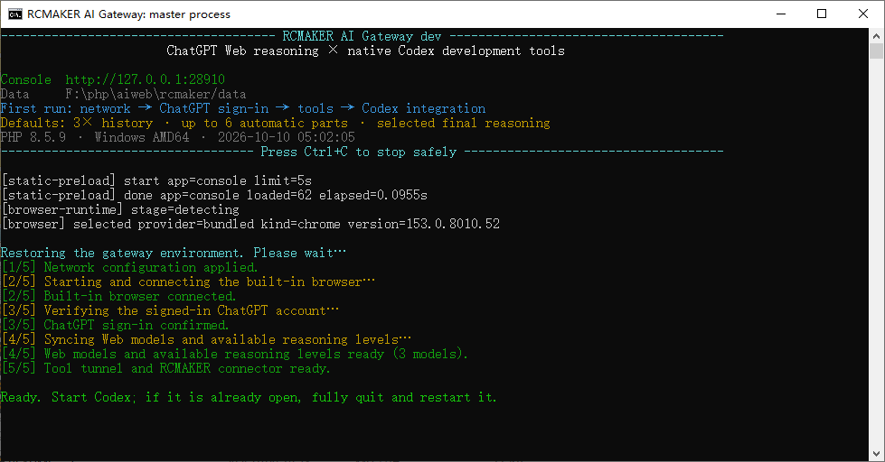

# RCMAKER Codex Gateway

**Use ChatGPT Web models for local work in Codex.**

**English** · [简体中文](README.zh-CN.md)

[Install a binary](#binary-install) · [Run from source](#source-install) · [First-time setup](#quick-start) · [User guide](docs/user-guide.en.md) · [Troubleshooting](docs/faq.en.md)

RCMAKER Codex Gateway connects your local Codex workflow to ChatGPT Web. Submit a task in Codex; the gateway delivers its context to the Web model, routes tool calls back to Codex, and streams progress and answers into the same conversation. File access, commands and approvals stay with your Codex runtime.

Built with the [RCMAKER PHP framework](https://github.com/runchance/rcmaker).

## What you get

| Capability | In everyday use |
| --- | --- |
| Local tools and Web models | Work on project files with the tools, skills and MCP integrations available in Codex |
| Long-running work | Continue through tool calls and context handoffs; send corrections from the same Codex chat |
| Visible task activity | Watch up to five task pages, inspect timelines, and copy or download the full sent messages |
| Account-aware model selection | Detect available Web models and modes; identify gateway entries by their **RC (Web)** suffix |
| A local control panel | Configure sign-in, network access, context settings, language and local usage tracking |
| zstd request compression (v1.6.0+) | Binary packages from [Releases](https://github.com/runchance/rcmaker-codex-gateway/releases) include support; source deployments depend on PHP's zstd extension and the decoder self-test |
| Standalone or source deployment | Use a packaged executable, or run the PHP source; keep persistent data outside the binary |



*Startup checks show what is ready and what still needs your attention.*

## Before you install

You need Codex on the computer where the gateway will run, a ChatGPT account with access to the required Web models and custom MCP plugins, and permission to use a Secure MCP Tunnel. The setup wizard guides you through the Tunnel and its ordinary runtime API key. Account/workspace access follows [OpenAI's Tunnel requirements](https://developers.openai.com/api/docs/guides/secure-mcp-tunnels).

Choose **one** installation method below. Packaged releases include PHP; source installations require PHP and Composer.

<a id="binary-install"></a>

## Install a binary

**Recommended for using the gateway without setting up PHP.** The installer downloads the latest stable [Release](https://github.com/runchance/rcmaker-codex-gateway/releases/latest), selects your platform and verifies SHA-256 checksums.

### Windows · x64

Run in PowerShell:

```powershell
irm https://raw.githubusercontent.com/runchance/rcmaker-codex-gateway/master/.github/scripts/install.ps1 | iex
```

Open the installation folder printed by the script and double-click **`rcmaker-codex-gateway.exe`**.

### Linux / macOS · x64 and ARM64

Run in Bash:

```bash
curl -fsSL https://raw.githubusercontent.com/runchance/rcmaker-codex-gateway/master/.github/scripts/install.sh | bash
```

In the installation folder, start:

```bash
./rcmaker-codex-gateway
```

By default, a fresh installation uses `./rcmaker-codex-gateway/`; an existing installation in the current folder is reused. An interactive first install lets you choose another folder. To set the location explicitly, define `RCMAKER_INSTALL_DIR` **before** running the installer. The installer does not start the application automatically.

Prefer a manual download? Get the archive for your system from Releases, extract it into a writable folder, and run the included executable. See [custom directories and manual installation](docs/user-guide.en.md#binary-install). Installer sources: [PowerShell](.github/scripts/install.ps1) · [Bash](.github/scripts/install.sh).

<a id="source-install"></a>

## Run from source

**For contributors and users who maintain their own PHP environment.** Prepare PHP 8.1–8.5 and Composer; the [source installation guide](docs/user-guide.en.md#source-install) covers extensions and environment checks.

```bash
git clone https://github.com/runchance/rcmaker-codex-gateway.git
cd rcmaker-codex-gateway
composer install
php index.php start
```

Deployment overrides are optional; see [`.env.example`](.env.example). Source and binary installations use the same setup flow below.

<a id="quick-start"></a>

## First-time setup

Keep the gateway running and open the **[local console](http://127.0.0.1:28910/)**. A required setup wizard opens on first use. Choose its language at the top right; the default is English. Other console pages become available after setup completes.

Progress is saved automatically. If you close or restart RCMAKER partway through, the wizard resumes at the first unfinished step.

| Step | What to do | Continue when |
| --- | --- | --- |
| 1. Network | Choose direct access or enter an HTTP proxy; select **Save and test** | The network check passes |
| 2. Components | Select **Prepare runtime components → Start preparation** | Private Chrome and tunnel components are ready |
| 3. ChatGPT | Open the sign-in page; use **Open native browser** for direct interaction | Your account and available models are detected |
| 4. Tunnel | Save the Tunnel ID, runtime API key and connector name | The tunnel is connected |
| 5. Connector | Create the matching ChatGPT plugin and select **Check connector** | The connector check passes |
| 6. Codex integration | **Preview integration → Save integration**, then **Open workspace** | The configuration is detected |

The default connector name is **RCMAKER Codex**. Its suffix is editable; copy the full name into ChatGPT exactly. **Connect the tunnel before creating the plugin.** The [illustrated setup guide](docs/user-guide.en.md#connect-tools) shows each field.

The integration check recognizes both `# RCMAKER BEGIN` and `# RCMAKER END` comments in Codex configuration. Identifier suffixes may be old or different; no matching installation journal is required for detection. Configuration writes still use preview and backup.

This completes only the Codex configuration step. Network, runtime, sign-in, tunnel and connector checks must also pass before the setup overlay closes.

> **After saving integration, wait for the gateway's Ready message, then fully quit and reopen Codex, including background processes. Keep RCMAKER running. Opening a new chat is not a restart.**

In Codex, open your project and choose an available model ending in **RC (Web)**. Thinking offers its detected effort choices; Pro has a separate entry when available. Try this first:

```text
Read this project's README and directory structure. Explain how to run the project
and identify any missing setup steps. Do not modify files.
```

Check the answer against the real tool output. **Browser workspace** shows the task page; **Task center** records its messages and results. You can then submit a development task with a clear outcome.

The console remembers opened tabs and the active page. Switching back refreshes status while preserving unsaved form input. Automatic redraw waits while you copy, type, scroll or drag; inactive tabs pause polling. After a confirmed sign-in reset, the wizard guides sign-in again, syncs models and checks the saved connector automatically.

<a id="troubleshooting"></a>

## Need help?

| What you see | Start here |
| --- | --- |
| Cannot start, open the console, or download Chrome | [Startup and network](docs/faq.en.md#network) |
| Connector check fails or local tools return 502/404 | [Connection checks](docs/user-guide.en.md#troubleshooting) |
| Web models or Pro are missing from Codex | [Models and restart checks](docs/faq.en.md#models) |
| Repeated compaction, interrupted output or a 409 conflict | [Task recovery](docs/faq.en.md#recovery) |
| Questions about context limits or estimated usage | [Context](docs/faq.en.md#history) · [Usage](docs/faq.en.md#usage) |

Model access and limits depend on your account. The default **3× history intake / six-part maximum** helps transport longer history; it does not enlarge a model's context window. Local token and Pro estimates are not official balances. See [settings and usage](docs/user-guide.en.md#settings).

## Updates and documentation

To update a binary installation, finish active tasks, stop RCMAKER, enter the **existing installation folder**, and rerun the installer. Preserve `.env` and `data/`; the latter is created on first use beside the executable. Full instructions: [upgrade and recovery](docs/user-guide.en.md#upgrade).

| Documentation | Purpose |
| --- | --- |
| [User guide](docs/user-guide.en.md) | Installation, illustrated setup, everyday use, settings and upgrades |
| [FAQ](docs/faq.en.md) | Symptom-based troubleshooting and explanations |
| [Deployment settings](.env.example) | Optional ports, data directory name and startup language |

For maintainers, pushing a version tag triggers builds and English Release notes. Each `Release-Note-EN:` line in a commit body becomes a visible change on the Release page; use one line per change. All commits since the previous eligible release are included. English commit subjects are used when no note is provided. Chinese subjects need English note lines or a committed `.github/release-notes/<tag>.en.md` override; missing details produce an explicit error rather than an incomplete release.

```text
Release-Note-EN: Restore the six-step setup wizard.
Release-Note-EN: Preserve unsaved input when switching console tabs.
```

## License and notices

[Apache-2.0](LICENSE) · [NOTICE](NOTICE) · [Third-party notices](THIRD_PARTY_NOTICES). The console also uses Pear Admin/Layui.

This project is provided for research and learning purposes only. Users are responsible for ensuring that their use complies with applicable laws, service terms and the rights of third parties. The authors do not authorize any use that infringes the rights of any third-party rights holder. The maintainers do not guarantee timely responses to issues, feature requests or support questions.

This is an independent project, not an official OpenAI product. ChatGPT, Codex and Chrome names belong to their respective owners.
