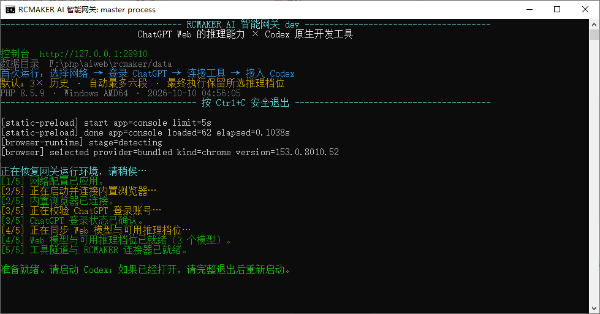

# RCMAKER Codex Gateway

**在 Codex 中使用 ChatGPT 网页模型，完成本地项目任务。**

**简体中文** · [English](README.md)

[二进制安装](#binary-install) · [源码安装](#source-install) · [首次配置](#quick-start) · [操作手册](docs/user-guide.zh-CN.md) · [常见问题](docs/faq.zh-CN.md)

RCMAKER Codex Gateway 连接本机 Codex 与 ChatGPT 网页模型。你在 Codex 中提出需求，网关负责传递上下文、将工具调用交给 Codex 执行，再把进展和答案实时返回同一条对话。文件访问、命令执行和权限审批仍由现有 Codex 运行时负责。

本项目基于 [RCMAKER PHP 框架](https://github.com/runchance/rcmaker) 开发。

## 你可以用它做什么

| 能力 | 使用体验 |
| --- | --- |
| 网页模型与本地工具协作 | 使用 Codex 已有的工具、技能与 MCP 集成处理项目文件 |
| 持续推进任务 | 在工具调用和上下文交接之间继续工作，也能从同一条 Codex 对话补充要求 |
| 看得见的执行过程 | 查看最多五个任务页面、任务时间线，复制或下载完整发送原文 |
| 按账号识别模型 | 检测可用网页模型与档位，通过 **RC (Web)** 后缀区分网关模型 |
| 本机可视化控制台 | 管理登录、网络、上下文设置、界面语言与本机用量记录 |
| 二进制或源码部署 | 直接运行独立程序，或使用 PHP 源码；持久数据保存在程序外部 |



*启动时逐项显示检查进度，准备就绪后提示启动或重启 Codex。*

## 安装前准备

在运行网关的电脑上安装 Codex，准备具有所需网页模型和自定义 MCP 插件权限的 ChatGPT 账号，以及可使用 Secure MCP Tunnel 的权限。控制台会引导创建 Tunnel 和普通运行 API Key；账号与工作区权限请核对 [OpenAI Tunnel 官方说明](https://developers.openai.com/api/docs/guides/secure-mcp-tunnels)。

下面两种安装方式**选择一种即可**。二进制已包含 PHP 运行环境；源码安装需要自行准备 PHP 和 Composer。

<a id="binary-install"></a>

## 二进制安装

**适合直接使用，无需自行配置 PHP。** 安装脚本从 [Releases 最新正式版](https://github.com/runchance/rcmaker-codex-gateway/releases/latest) 下载对应平台的发行包，并校验 SHA-256。

### Windows · x64

在 PowerShell 执行：

```powershell
irm https://raw.githubusercontent.com/runchance/rcmaker-codex-gateway/master/.github/scripts/install.ps1 | iex
```

打开脚本提示的安装目录，双击 **`rcmaker-codex-gateway.exe`** 启动。

### Linux / macOS · x64 与 ARM64

在 Bash 执行：

```bash
curl -fsSL https://raw.githubusercontent.com/runchance/rcmaker-codex-gateway/master/.github/scripts/install.sh | bash
```

进入安装目录后启动：

```bash
./rcmaker-codex-gateway
```

全新安装默认放在 `当前目录/rcmaker-codex-gateway/`；当前目录已有程序时原位更新。首次交互式安装可以选择其他目录，也可在执行命令**之前**设置 `RCMAKER_INSTALL_DIR`。脚本完成后不会自动启动程序。

也可手动下载：从 Releases 选择对应系统和架构的压缩包，解压到有写入权限的目录，再运行其中的程序。详见[指定目录与手动安装](docs/user-guide.zh-CN.md#binary-install)。安装脚本：[PowerShell](.github/scripts/install.ps1) · [Bash](.github/scripts/install.sh)。

<a id="source-install"></a>

## 源码安装

**适合参与开发，或自行维护 PHP 环境的用户。** 先准备 PHP 8.1–8.5 与 Composer；扩展和环境检查见[源码安装手册](docs/user-guide.zh-CN.md#source-install)。

```bash
git clone https://github.com/runchance/rcmaker-codex-gateway.git
cd rcmaker-codex-gateway
composer install
php index.php start
```

部署参数可按需参照 [`.env.example`](.env.example) 配置。源码与二进制启动后，均按下面的流程接入 Codex。

<a id="quick-start"></a>

## 首次配置

保持网关运行，打开 **[本机控制台](http://127.0.0.1:28910/)**。首次使用会打开必须完成的初始化向导，右上角可以选择语言，默认英文。完成后才可操作其他控制台页面。

进度自动保存。中途关闭或重启 RCMAKER 后，从首个未完成步骤继续。

| 步骤 | 操作 | 完成标志 |
| --- | --- | --- |
| 1. 网络 | 选择直连，或填写 HTTP 代理，点击“保存并测试” | 网络检查通过 |
| 2. 运行组件 | 点击“准备运行组件 → 开始准备” | 私有 Chrome 与隧道组件就绪 |
| 3. ChatGPT | 打开登录页面；需要直接操作时使用“打开原生浏览器” | 账号与可用模型识别完成 |
| 4. 工具隧道 | 保存 Tunnel ID、普通 API Key 和连接器名称 | 隧道已连接 |
| 5. 连接器 | 创建对应的 ChatGPT 插件，点击“检查连接器” | 连接器检查通过 |
| 6. 接入 Codex | “预览接入配置 → 保存接入配置”，再点击“进入控制台” | 检测到接入配置 |

连接器默认名为 **RCMAKER Codex**，后缀可以自定义；ChatGPT 中必须填写相同的完整名称。**先连接隧道，再创建插件。** 字段填写和截图见[连接操作手册](docs/user-guide.zh-CN.md#connect-tools)。

接入检查识别 Codex 配置里的 `# RCMAKER BEGIN` 和 `# RCMAKER END` 两条注释。标记后缀可以是旧值或不同值，也不要求存在相同的安装记录。写入配置仍通过预览和备份完成。

这只代表 Codex 配置步骤完成。网络、组件、登录、隧道和连接器仍须分别通过检查，初始化遮罩才会解除。

> **保存接入配置后，等待网关显示“准备就绪”，再完全退出并重新打开 Codex，包括后台进程。RCMAKER 保持运行。新建聊天不能代替重启。**

在 Codex 中打开项目，选择名称以 **RC (Web)** 结尾的可用模型。Thinking 使用检测到的推理档位，Pro 可用时单独列出。首次可以发送：

```text
读取这个项目的 README 和目录结构，说明如何启动，以及缺少哪些配置。
这次先不要修改文件。
```

核对回答与真实工具结果。“浏览器工作区”显示对应网页，“任务中心”记录消息与执行结果。通过后即可提交具有明确目标的开发任务。

控制台记住打开的标签和当前页面。切回页面时刷新状态，保留未保存的表单；复制、输入、滚动和拖动期间延后自动重绘，非活动标签暂停轮询。确认清空登录资料后，向导会重新引导登录、同步模型并自动检查已保存的连接器。

<a id="troubleshooting"></a>

## 遇到问题，从这里查

| 现象 | 查看位置 |
| --- | --- |
| 程序启动失败、控制台打不开、Chrome 下载失败 | [启动与网络](docs/faq.zh-CN.md#network) |
| 连接器检查失败，本地工具返回 502/404 | [连接排查](docs/user-guide.zh-CN.md#troubleshooting) |
| Codex 没有网页模型或缺少 Pro | [模型与重启检查](docs/faq.zh-CN.md#models) |
| 反复压缩、连接中断或 409 冲突 | [任务恢复](docs/faq.zh-CN.md#recovery) |
| 不明白上下文限制或用量估算 | [上下文](docs/faq.zh-CN.md#history) · [用量](docs/faq.zh-CN.md#usage) |

模型权限和限额取决于账号。默认的 **3× 历史接入 / 最多六段**用于传输较长历史，不会扩大模型自身的上下文窗口。本机 Token 与 Pro 次数估算不是官方余额。详见[设置与用量](docs/user-guide.zh-CN.md#settings)。

## 更新与文档

二进制升级前先结束任务、关闭 RCMAKER，进入**原安装目录**后重新执行安装命令。保留 `.env` 和 `data/`；`data/` 会在首次使用时自动创建于程序旁。完整步骤见[升级与恢复](docs/user-guide.zh-CN.md#upgrade)。

| 文档 | 用途 |
| --- | --- |
| [用户操作手册](docs/user-guide.zh-CN.md) | 安装、配置截图、日常使用、设置和升级 |
| [常见问题 FAQ](docs/faq.zh-CN.md) | 按现象定位故障，解释常见疑问 |
| [部署配置示例](.env.example) | 按需修改端口、数据目录名称与启动语言 |

维护者推送版本 tag 后，会自动构建并生成英文 Release 说明。提交正文中每条 `Release-Note-EN:` 都会直接显示为一项修改，一项修改写一行；列出上个有效版本以来的全部提交。有英文提交标题时可直接使用标题；中文标题需提供英文说明，或提交 `.github/release-notes/<tag>.en.md` 完整覆盖文件。缺少内容会明确报错，不再发布只有分类和链接的空说明。

```text
Release-Note-EN: Restore the six-step setup wizard.
Release-Note-EN: Preserve unsaved input when switching console tabs.
```

## 协议与声明

[Apache-2.0](LICENSE) · [NOTICE](NOTICE) · [第三方声明](THIRD_PARTY_NOTICES)。控制台使用 Pear Admin/Layui。

本项目仅供研究和学习使用。用户应自行确保使用方式符合相关法律、服务条款以及第三方权利要求。作者不授权任何以本项目侵犯第三方权利人权益的行为，也不承诺能够及时处理所有 Issue、功能请求或支持问题。

本项目不是 OpenAI 官方产品。ChatGPT、Codex、Chrome 名称属于各自权利人。
