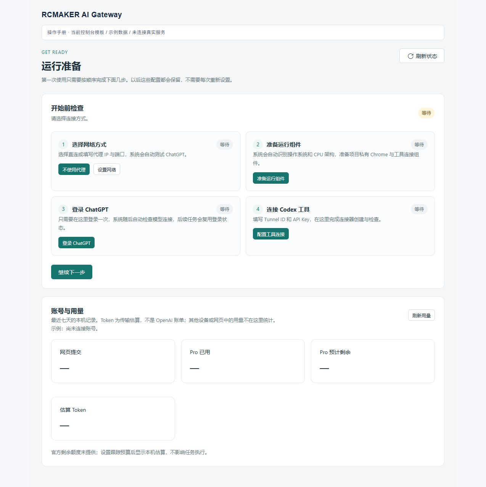
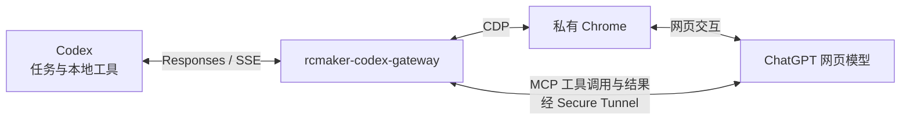

# rcmaker-codex-gateway

**简体中文** · [English](README.md)

把 ChatGPT 网页模型接入本机 Codex 开发流程。在 Codex 中提出需求，网关负责传递上下文、转发原生工具调用，并实时回传模型公开的进展和最终答案。

**本应用基于 [RCMAKER PHP 框架](https://github.com/runchance/rcmaker) 开发。** 文件修改、命令执行、浏览器操作、技能及已配置的 MCP 工具由现有 Codex 运行时执行，遵守其自身的权限与审批规则。

## 文档入口

| 从这里开始 | 内容 |
| --- | --- |
| **[图文操作手册](docs/user-guide.zh-CN.md)** | 安装、逐步配置截图、首次任务、日常操作和升级 |
| **[常见问题 FAQ](docs/faq.zh-CN.md)** | 连接失败、模型选择、上下文压缩、用量与恢复 |

| [English documentation](README.md) | 独立的英文 README、操作手册与 FAQ |



*截图使用当前控制台模板和明确标注的示例数据，不包含真实账号凭据或私有项目对话。*

## 为什么采用 RCMAKER

[RCMAKER](https://github.com/runchance/rcmaker) 面向 PHP 应用的快速开发与独立交付：

| 框架能力 | 对本应用的价值 |
| --- | --- |
| PHP 与 Composer 生态 | 延续熟悉的开发方式，复用成熟组件 |
| CLI 常驻服务 | 减少持续运行网关的重复初始化开销 |
| 多应用与进程组 | 分离控制台、API 与后台运行职责 |
| 独立可执行程序打包 | 将 PHP、应用代码与依赖一起交付 |

框架源码：**https://github.com/runchance/rcmaker**。框架文档：[rcmaker.runchance.com](https://rcmaker.runchance.com/)。

## 主要功能

- 原生 Codex 工具调用、并行调用和长时间运行的命令会话，保留真实执行回执。
- 流式显示公开进展、推理状态摘要和 Markdown 答案，提供任务浏览器工作区与历史记录。
- 最多五个任务页面，支持中途追加引导、模型切换、附件传输和上下文交接。
- 新安装默认开启 **3× 历史接入与最多六段自动传输**：历史分段用非 Pro 中档，摘要用非 Pro 高档，实际任务用所选模型与强度。
- 独立于系统 Chrome 的私有 Chrome for Testing，同时提供内嵌界面和原生窗口登录。
- 中英双语控制台，日常设置与模型契约分开，支持发送原文复制/下载及本机用量估算。
- 独立程序部署，持久数据保存在可执行文件外部。

可用模型、档位和账号功能以当前 ChatGPT 检测结果为准。任务时长取决于需求范围，不保证最低运行时间，也不会扩大模型本身的上下文窗口。

## 工作原理

Codex 通过兼容 Responses 的本地接口将任务交给网关；网关使用私有 Chrome 向 ChatGPT 网页模型传递上下文，并把进展与回答流式返回 Codex。网页模型需要工具时，通过 Secure MCP Tunnel 将调用送回网关，再交由 Codex 原生工具按原有权限执行，真实执行结果沿原路返回。



## 快速开始

### 1. 启动应用

将下载的 Windows 程序放入有写入权限的文件夹，**双击 `.exe` 即可启动**，无需添加 `start` 参数。也可以在 PowerShell 中运行（文件名以实际下载的为准）：

```powershell
.\rcmaker-codex-gateway.exe
```

首次运行无需提前准备 `data`，程序会在可执行文件旁创建持久数据目录。随后打开[本机控制台](http://127.0.0.1:28910/)。

源码运行支持 **PHP 8.1–8.5（含）**，适用于 Windows、macOS 和 Linux。推荐先按 [RCMAKER 官网快速入门：准备环境](https://rcmaker.runchance.com/doc/#/md/quick-start?id=_1-%E5%87%86%E5%A4%87%E7%8E%AF%E5%A2%83) 安装和配置 PHP、所需扩展及 Composer，再进入本项目源码目录执行：

```sh
composer install
php index.php start
```

使用独立程序时，请下载与自己的操作系统和处理器架构匹配的版本。

### 2. 按顺序完成运行准备

| 步骤 | 操作 | 完成标志 |
| --- | --- | --- |
| 1 · 网络 | 选择直连或填写 HTTP CONNECT 代理，点击“保存并测试” | 网络连接确认 |
| 2 · 运行组件 | 准备私有 Chrome 与工具隧道组件 | 组件就绪 |
| 3 · ChatGPT | 在私有登录页面或其原生窗口登录 | 账号与模型检查通过 |
| 4 · Codex 工具 | 保存 Tunnel ID、普通运行 API Key 和连接器名称，创建名称匹配的 ChatGPT 插件 | “检查连接器”通过 |
| Codex 接入 | 检测模型、预览并保存接入配置 | 配置已保存，且已完整重启 Codex |

[图文手册](docs/user-guide.zh-CN.md#connect-tools) 提供字段说明、截图和准确顺序。新安装默认连接器名为 **RCMAKER Codex**，后缀可自定义；控制台与 ChatGPT 中的完整名称必须一致。

**请等待 Shell 控制台明确显示** `准备就绪。请启动 Codex；如果已经打开，请完整退出后重新启动。` 此时网络、浏览器、ChatGPT 登录、模型检测和连接器均已就绪。如果仍提示某一步正在等待，请先返回本机控制台完成配置。

> **保存接入配置后，请先保存工作，完全退出 Codex（包括后台进程），再重新打开。RCMAKER 保持运行。新建聊天不能代替重启 Codex。**

### 3. 发起首次任务

在 Codex 打开项目，选择名称以 **RC (Web)** 结尾的可用模型，例如 `GPT-6 · Thinking · RC (Web)`，再选择推理强度。Pro 可用时单独列出。

先做一个范围明确、容易核对的任务：

```text
检查这个项目的目录结构和 README，说明如何启动，并列出缺少的配置步骤。
这次先不要修改文件。
```

确认 Codex 显示真实工具结果，“浏览器工作区”出现任务页面，“任务中心”记录交互，再提出带目标和使用要求的开发需求。详见[首次任务使用](docs/user-guide.zh-CN.md#first-task)。

## 账号、密钥与用量

ChatGPT 账号应具有所需模型和自定义 MCP 应用权限。为私有浏览器使用的 ChatGPT 账号/工作区配置有访问权限的 Tunnel 和普通运行 API Key；Codex 桌面端可以登录不同账号。按控制台引导及 [OpenAI Secure MCP Tunnel 官方说明](https://developers.openai.com/api/docs/guides/secure-mcp-tunnels) 配置。

用量统计仅覆盖本机安装，不包含其他设备。Token 与 Pro 剩余次数属于**本机估算，不是官方账单或官方余额**。“用官方模型生成交接摘要”默认关闭，开启后可能消耗官方 Codex 模型额度。详见[用量 FAQ](docs/faq.zh-CN.md#usage)。

## 升级与持久数据

保留外置 `data` 和实际使用的 `.env`，等待任务结束后再替换程序、重启。发行包中不得包含开发机的数据、Cookie、密钥或真实 `.env`。

```text
application/
  rcmaker-codex-gateway-<version>.exe
  .env             # 可选的部署配置
  data/            # 首次使用创建，升级时保留
  runtime/         # 可重建的运行文件
```

详见[升级操作](docs/user-guide.zh-CN.md#upgrade)。公开的操作手册和截图放在 `docs/`；运行数据 `data/` 属于私有目录，不应打包发布。

## 开发与发布

使用框架维护的交互式构建入口：

```sh
php -d phar.readonly=0 index.php interact
```

排除真实 `.env` 和外置数据目录，源码及二进制分发均保留许可证与归属声明。公开的 `docs/` 仅收录面向用户的操作手册、常见问题和截图。

## 使用声明

本项目仅供研究和学习使用。用户应自行确保使用方式符合相关法律、服务条款以及第三方权利要求。作者不授权任何以本项目侵犯第三方权利人权益的行为。

作者不承诺能够及时处理所有 Issue、功能请求或支持问题。

## 协议与致谢

**Apache-2.0**：[LICENSE](LICENSE)、[NOTICE](NOTICE)、[第三方声明](THIRD_PARTY_NOTICES)。

基于 [RCMAKER](https://github.com/runchance/rcmaker)、Pear Admin/Layui 与原生 Codex 工具开发。

本项目不是 OpenAI 官方产品。ChatGPT、Codex、Chrome 名称属于各自权利人。

