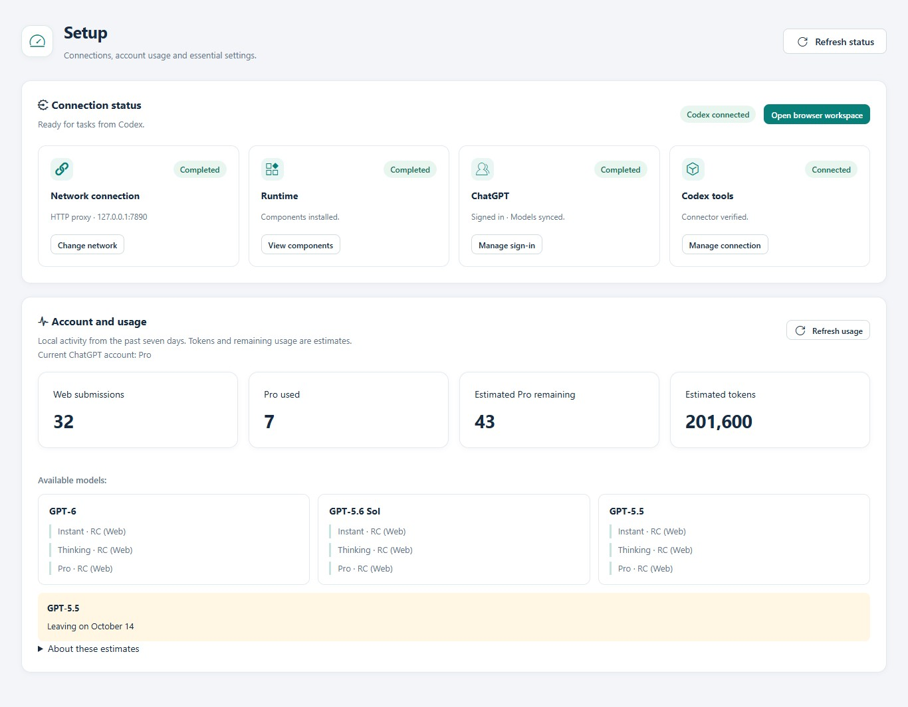
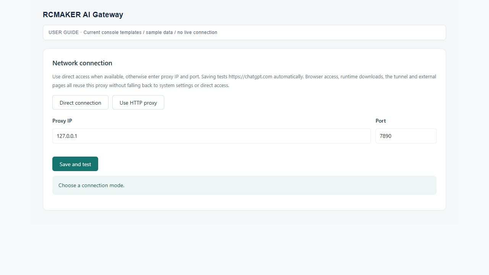
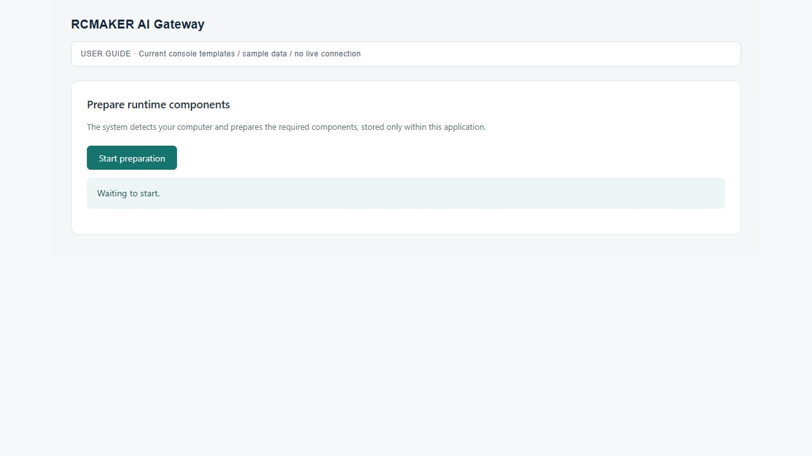
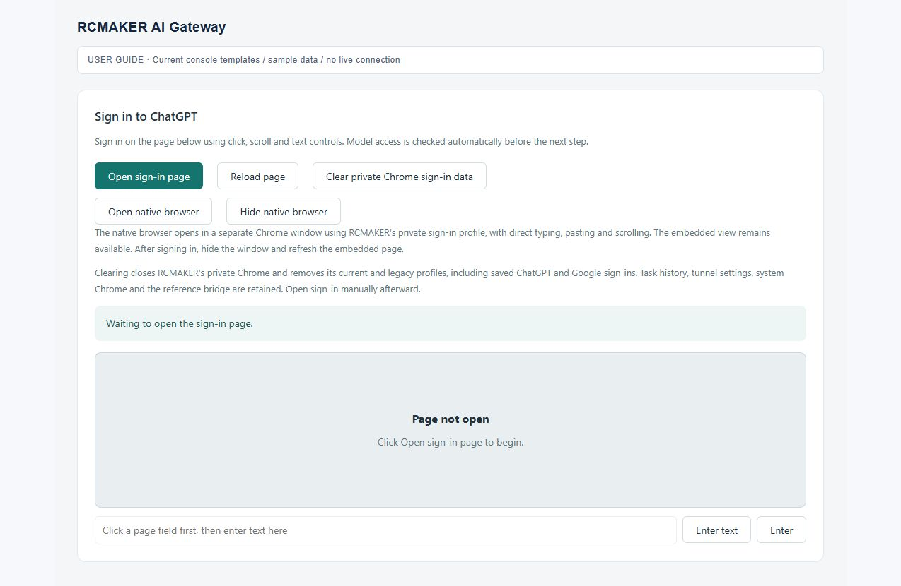
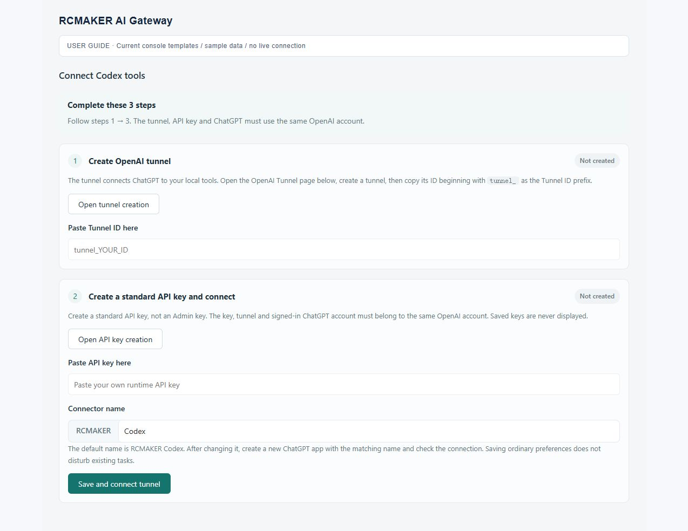
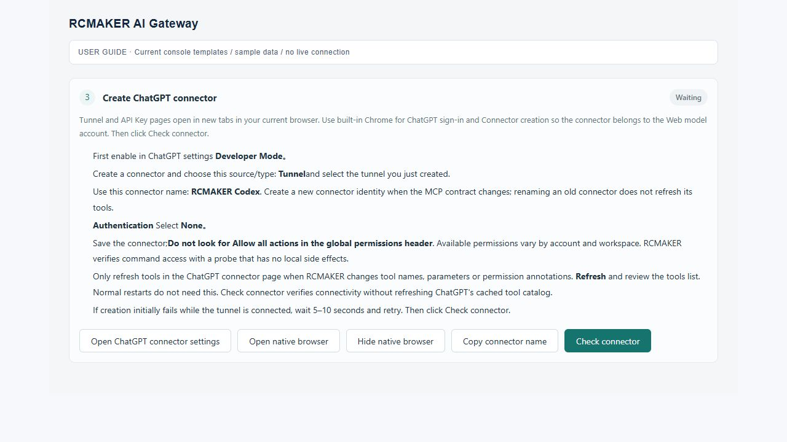
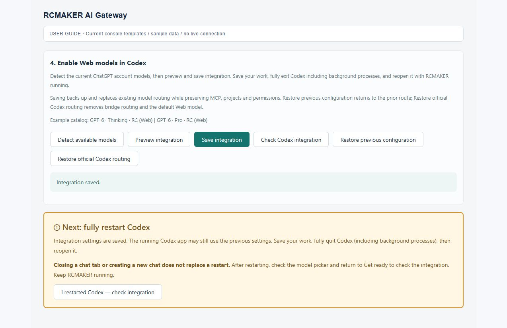
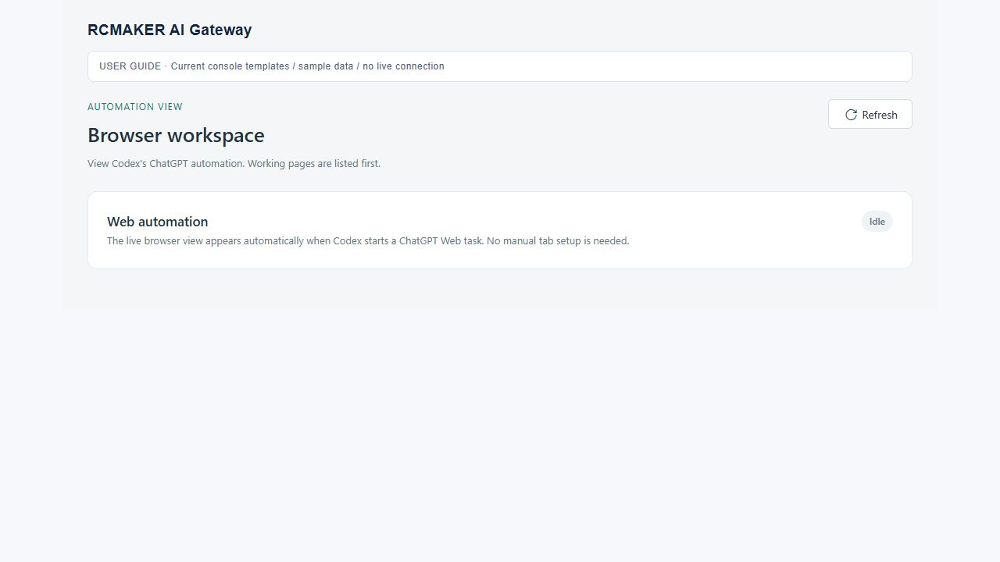
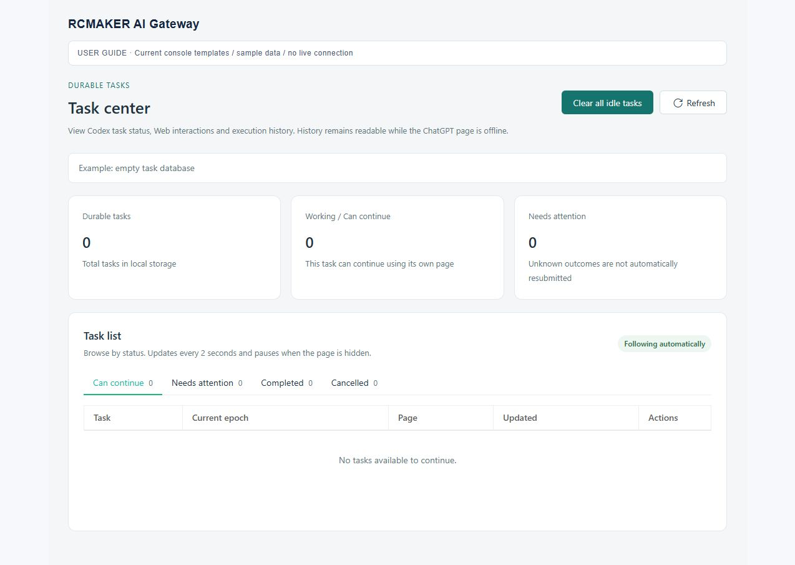
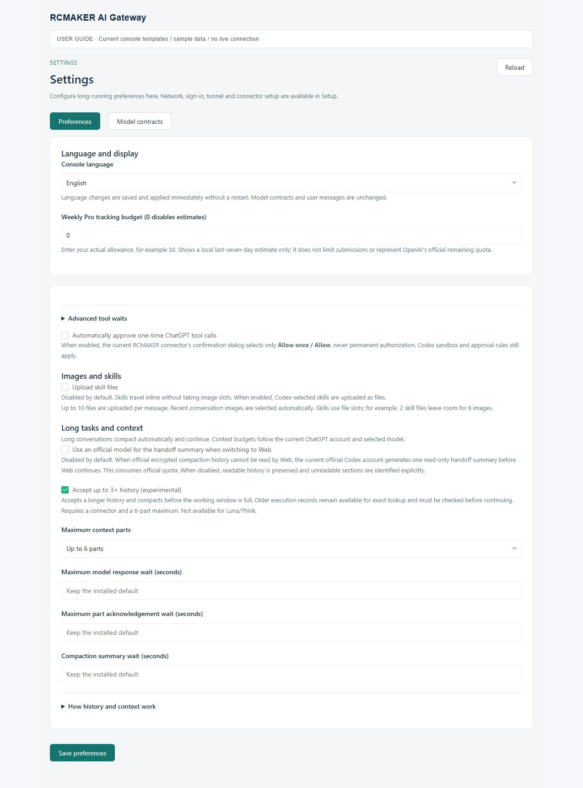

# RCMAKER Codex Gateway · User Guide

**English** · [简体中文](user-guide.zh-CN.md) · [Project overview](../README.md) · [FAQ](faq.en.md)

First-time setup: **choose an installation method → prepare the gateway → connect and restart Codex → run a task**. Already configured? Jump to everyday use or troubleshooting.

| What you need | Start here |
| --- | --- |
| Check the requirements | [1. Before you start](#before-start) |
| Download a ready-to-run application | [2. Binary installation](#binary-install) |
| Run the PHP source | [3. Source installation](#source-install) |
| Configure network, components and sign-in | [4. Setup](#setup) |
| Create the connector and enable Codex models | [5. Tool connection and Codex integration](#connect-tools) |
| Start work and inspect its progress | [6. First task](#first-task) · [7. Everyday use](#daily-use) |
| Change language, context or usage settings | [8. Settings](#settings) |
| Update, restore or resolve a problem | [9. Upgrades and recovery](#upgrade) · [10. Troubleshooting](#troubleshooting) |

Controls were checked against the project files on **10 October 2026**. Configuration screenshots use console templates and sample data to illustrate the controls. Use your own interface for actual connection status, account permissions and available models.

<a id="before-start"></a>

## 1. Before you start

### Understand the three windows

| Window | What you do there |
| --- | --- |
| **Codex** | Open the project, submit requests, handle approvals, review changes and results |
| **RCMAKER local console** | Configure the gateway and inspect readiness, task records and browser activity |
| **RCMAKER private Chrome** | Sign in to ChatGPT and create its plugin; the gateway manages task pages |

The embedded view and **Open native browser** window share the private browser profile. They are separate from your regular system Chrome. **Signing in through system Chrome alone does not sign the gateway in.**

### Prepare access, networking and a folder

Use the computer where Codex is installed and choose a folder you can write to. Initial setup needs network access to download components, sign in to ChatGPT and connect the tool tunnel. The binary includes PHP; it does not make the gateway an offline application.

Use a ChatGPT account with the required Web models and custom MCP plugin access, plus a Platform account/workspace with the necessary Tunnel permissions. Follow the console's account-matching guidance for the private ChatGPT login, Tunnel and ordinary runtime API key; the desktop Codex login can differ. **The same email address does not establish all workspace permissions.** Check Tunnel organization/workspace associations and the separate create/use permissions in [OpenAI's guide](https://developers.openai.com/api/docs/guides/secure-mcp-tunnels).

<a id="install"></a>

| Installation | Best for | Install PHP / Composer yourself? |
| --- | --- | --- |
| [Binary](#binary-install) | Using the gateway directly | No |
| [Source](#source-install) | Contributing or maintaining a PHP environment | Yes |

**Choose one.** Both continue with [Setup](#setup) after startup.

<a id="binary-install"></a>

## 2. Binary installation

### 2.1 Automatic installation

**Windows x64:** run in PowerShell.

```powershell
irm https://raw.githubusercontent.com/runchance/rcmaker-codex-gateway/master/.github/scripts/install.ps1 | iex
```

**Linux / macOS:** run in Bash. Both x64 and ARM64 are supported by the installer.

```bash
curl -fsSL https://raw.githubusercontent.com/runchance/rcmaker-codex-gateway/master/.github/scripts/install.sh | bash
```

The installer downloads the latest stable release and verifies SHA-256 checksums for the archive and executable. Windows needs system `tar.exe`; the Linux/macOS installer checks its download, extraction and checksum tools. Install any missing prerequisite identified in an error before retrying. Script sources: [Windows](../.github/scripts/install.ps1) · [Linux/macOS](../.github/scripts/install.sh).

**Destination:** an executable in the current folder is upgraded there; otherwise the default is `./rcmaker-codex-gateway/`. A first interactive installation lets you enter a different directory. Non-interactive installation uses the default. Check the script's final output for the actual location.

<details>
<summary>Choose a custom installation directory</summary>

Set the directory before running the installer. Replace the example path with your preferred location.

Windows:

```powershell
$env:RCMAKER_INSTALL_DIR = 'D:\Apps\RCMAKER-Gateway'
irm https://raw.githubusercontent.com/runchance/rcmaker-codex-gateway/master/.github/scripts/install.ps1 | iex
```

Linux / macOS:

```bash
export RCMAKER_INSTALL_DIR="$HOME/Apps/rcmaker-codex-gateway"
curl -fsSL https://raw.githubusercontent.com/runchance/rcmaker-codex-gateway/master/.github/scripts/install.sh | bash
```

To install into the current directory, set the variable to `.`. Relative paths resolve from the directory where you run the command. In Bash, `export` the variable first; assigning it only to `curl` on the left of the pipe does not pass it to `bash`.

</details>

### 2.2 Manual installation

Open [Releases](https://github.com/runchance/rcmaker-codex-gateway/releases/latest) and choose the matching release archive. For the ready-to-run application, do not choose GitHub's automatically generated **Source code** archives.

| Computer | Archive filename ending |
| --- | --- |
| Windows x64 | `windows-x86_64.zip` |
| Linux x64 | `linux-x86_64.tar.gz` |
| Linux ARM64 | `linux-aarch64.tar.gz` |
| macOS Intel | `macos-x86_64.tar.gz` |
| macOS Apple Silicon | `macos-aarch64.tar.gz` |

Extract the archive into a writable folder and keep its license files and configuration example. You do not need an existing `data/` directory or another user's browser profile. Available downloads are those attached to the selected Release.

### 2.3 Start the application

The installer **does not start** the gateway. Open the installation or extraction directory:

| System | Start command or action |
| --- | --- |
| Windows | Double-click `rcmaker-codex-gateway.exe`, or run `.\rcmaker-codex-gateway.exe` in PowerShell |
| Linux / macOS | Run `./rcmaker-codex-gateway` in a terminal |

If a manually extracted executable lacks execute permission, run `chmod +x ./rcmaker-codex-gateway` first. Resolve missing browser libraries or graphical-session requirements from the actual error; a platform-specific binary does not include every operating-system component.

Keep the process running, open the **[local console](http://127.0.0.1:28910/)** on the same computer, and continue with [section 4](#setup). The default `data/` directory is created beside the executable on first use.

<a id="source-install"></a>

## 3. Source installation

**Skip this section if you installed a binary.**

### 3.1 Prepare PHP

Install Git, Composer and PHP 8.1–8.5 for CLI use. The release build uses PHP 8.5 with `curl`, `openssl`, `zip`, `mbstring`, `pdo_sqlite`, `sqlite3`, `sockets` and `sodium`; see the [build configuration](../.github/workflows/release.yml). Enable the runtime framework's required Unix process extensions as well.

The [RCMAKER environment guide](https://rcmaker.runchance.com/doc/#/md/quick-start?id=_1-%E5%87%86%E5%A4%87%E7%8E%AF%E5%A2%83) covers environment preparation. Check the terminal you will use to run the gateway:

```bash
php -v
php -m
composer --version
```

The CLI PHP must have the required extensions. Enabling them only in a different web-server/FPM PHP installation is not sufficient.

### 3.2 Get the source and start

```bash
git clone https://github.com/runchance/rcmaker-codex-gateway.git
cd rcmaker-codex-gateway
composer install
php index.php start
```

If you already downloaded the source, start with `composer install` in its root directory. Do not skip Composer's install scripts: this project uses them to apply its framework compatibility patch.

Default configuration can start as supplied. For deployment overrides, create `.env` using [`.env.example`](../.env.example); do not overwrite an existing `.env`. The default `data/` directory is inside the project root, not beside the PHP executable.

Keep the process running and open the **[local console](http://127.0.0.1:28910/)**. The remaining setup is the same as for a binary installation.

<a id="setup"></a>

## 4. Setup: network → components → sign-in

A fresh installation uses English. Choose the language at the top right of the setup wizard. After setup, use the top language menu or **Settings → Console language**. The preference is saved immediately without a restart.

First use opens a required overlay: **network → runtime → sign-in → tunnel → connector → Codex integration**. Only the current step's controls are available. Saved progress resumes after a refresh or restart. Select **Open workspace** after completing setup.

Existing installations see connection cards in Setup and can manage individual settings.



*Console illustration uses demo data. Account, model and usage values follow your actual detection results.*

### 4.1 Configure the network

Select **Configure network**. Choose **Direct connection** when the services are reachable directly, or **Use HTTP proxy** and enter its host and port. Select **Save and test**.

| Field | What to enter |
| --- | --- |
| Proxy IP / host | For example `127.0.0.1`, without `http://`, a username or a path |
| Port | The HTTP CONNECT port actually provided by your proxy software |
| Proxy authentication | Expand **Proxy authentication (optional)** for username and password; leave a saved password blank to keep it |

The saved route is used by the application browser, component downloads and tool tunnel. It does not change your system proxy. A SOCKS-only port cannot be entered as an HTTP port.

Choose the browser timezone in step 1 (network settings) or on the Network and proxy page, without editing configuration files. The default matches the proxy exit automatically. You can search for a city and select a timezone, such as Tokyo (`Asia/Tokyo`), or use the computer timezone. Automatic mode keeps the computer timezone for direct connections. Applying a new revision reinitializes a running private Chrome while preserving sign-in data. If Web tasks or browser operations are active, the revision is saved but remains pending until you apply it after the work finishes. A stopped browser uses the settings on its next launch. Return to step 1 whenever the timezone needs adjustment.

Automatic detection uses the browser's selected HTTP proxy to contact `ipwho.is`, then `ipapi.co` on failure, without sign-in data or chat content. For domain-based routing, send these sites and ChatGPT through the same exit, or select the exit location's timezone manually. If both lookups fail, startup reports `BROWSER_TIMEZONE_LOOKUP_FAILED` without guessing or bypassing the proxy. The timezone applies before scripts run on sign-in, task and connector-check pages; the Windows timezone is unchanged. Matching timezones does not guarantee that the site's `Model not found` error is resolved; verify the actual model request separately.

The timezone is resolved once per browser initialization and reused for new pages. A temporary page-control failure preserves healthy pages' overrides and rechecks the failed control sessions. New Web requests may report that the browser is not ready until recovery. `BROWSER_TIMEZONE_APPLY_FAILED` identifies a failure in the control workflow, not necessarily an invalid timezone; runtime logs record the specific CDP method and error. Recovery does not refresh pages, resend tasks or replay tools.

**Success:** the network check passes. A target website returning HTTP 403 differs from a proxy refusing the tunnel; connectivity also does not establish sign-in. See the [network FAQ](faq.en.md#network).

<details>
<summary>Show network configuration screenshot</summary>



The screenshot port is illustrative. Use your own proxy's port.

</details>

### 4.2 Prepare runtime components

Select **Prepare runtime components → Start preparation** and wait for private Chrome and the tool tunnel components. Configure networking before downloading components.

**Success:** the Runtime card reports ready. If a download fails, inspect networking, disk space and the exact error before continuing; creating another connector does not repair missing components.

<details>
<summary>Show runtime preparation screenshot</summary>



</details>

### 4.3 Sign in to ChatGPT

Select **Sign in to ChatGPT → Open sign-in page** and complete sign-in. For easier typing or scrolling, choose **Open native browser** and use the separate private Chrome window.

Account detection and model sync run automatically after sign-in; you do not need to open the page again. **Hide native browser** hides the window; use **Reload page** if the browser image itself needs refreshing.

**Success:** the account is recognized and model checks finish. Continue to the tool connection.

<details>
<summary>Show sign-in and native browser controls</summary>



</details>

**Clear private Chrome sign-in data is a reset.** It removes the application's saved ChatGPT/Google login state and profiles, requiring another sign-in. Do not use it for a routine refresh. Finish active tasks before deliberately resetting an account.

Confirming a reset immediately opens the sign-in step. After sign-in and model sync, the saved connector is checked automatically; follow the manual check prompt if it fails. Tasks and gateway settings remain saved, including the Tunnel ID and key.

<a id="connect-tools"></a>

## 5. Tool connection and Codex integration

During initialization, use the Tunnel and Connector steps. Afterwards, open **Setup → Manage connection**. Follow this order: **create a Tunnel → save the key and connect → create the ChatGPT plugin → check the connector → enable Codex models**.

### 5.1 Create and connect the Tunnel

Select **Open tunnel creation**, create a Tunnel and copy its `tunnel_...` identifier. Select **Open API key creation** and create an **ordinary runtime API key**, not an Admin key, with the required access.

These two buttons open tabs in the browser displaying the local console. Check its signed-in account so it matches the intended private ChatGPT account and workspace access.

| Local field | What to enter |
| --- | --- |
| Tunnel ID | The `tunnel_...` identifier you created |
| API Key | An ordinary runtime key allowed to use the Tunnel; leave blank when the key is already saved |
| Connector name | Fixed prefix `RCMAKER` plus your suffix; default `RCMAKER Codex` |

Select **Save and connect tunnel** and wait for Connected before proceeding. A normal first save activates the tunnel without a gateway restart.



### 5.2 Create the ChatGPT plugin and verify it

Select **ChatGPT Connector settings**, or **Open native browser** in that area, to create the plugin using the private Chrome account.

The current official flow is **Plugins → + → Add custom MCP server**. If your account still uses Apps / Developer Mode, follow that interface and any developer-mode or workspace permission requirements. See the [official creation steps](https://developers.openai.com/api/docs/guides/custom-mcp-server).

| ChatGPT field | Value for this integration |
| --- | --- |
| Name | The full value from **Copy connector name**, for example `RCMAKER Codex` |
| Connection | **Tunnel**, then choose the Tunnel from the previous step |
| Authentication | **No authentication / None** |

Review the page's notices, create the plugin and complete its installation/connection steps. Return to RCMAKER and select **Check connector**.

**Success:** both tunnel and connector checks pass. If the Tunnel is missing, check organization/workspace associations and permissions. If creation succeeds but the check fails, use the [connector FAQ](faq.en.md#connector).

<details>
<summary>Show the connector checklist</summary>



</details>

An existing installation keeps its connector name; there is no need to change it to the default. After changing the suffix, create and verify a matching plugin. Ordinary restarts do not require a new plugin. When release notes require updated tool definitions, use **Refresh / Refresh tools** in ChatGPT, then check the connection locally. These are separate actions.

<a id="codex-integration"></a>

### 5.3 Save the integration and restart Codex

In the same dialog, find **Enable Web models in Codex**:

1. Select **Detect available models** and wait for account detection to complete.
2. Select **Preview integration** and review the target configuration and routing changes.
3. Select **Save integration**.

Saving backs up and replaces model routing while preserving unrelated MCP, project and permission settings. When switching from another gateway, inspect the old route in the preview.



> **Wait for Ready in RCMAKER's startup window, then fully quit Codex, including background processes, and reopen it. Keep RCMAKER running. Closing a chat tab or opening a new chat is not a restart.**

**Configuration detection:** both actual `# RCMAKER BEGIN` and `# RCMAKER END` comments mean the configuration is integrated. Identifier suffixes need not match the current journal or URL. Examples inside strings and compression-only markers do not count. Detection does not rewrite configuration.

This check covers only the final Codex step. An unfinished earlier step keeps the setup overlay open, even when Codex configuration is already present.

After a full Codex restart, model names ending in **RC (Web)** should appear. A first real task verifies tool communication; it is not required to unlock the console. If Ready never appears, complete the remaining setup step.

<a id="first-task"></a>

## 6. Run and check your first task

Open the intended project in Codex and choose a detected **RC (Web)** model. Thinking entries offer the available effort choices; Web Pro uses a separate **Pro · RC (Web)** entry when available. Family names follow the current detection result.

Start with an easy-to-check read-only request:

```text
Read this project's README and directory structure. Explain how to run the project
and identify any missing setup steps. Do not modify files. Use actual file contents.
```

| Where to look | What should appear |
| --- | --- |
| Codex | Real tool calls and file results, followed by the answer |
| Browser workspace | An automatically created ChatGPT task page |
| Task center | Messages, tool receipts and status for the task |

After this succeeds, submit a concrete development request and handle approvals in Codex. Review the diff for file changes and actual command output for verification; a final “done” message is not enough on its own.

<a id="daily-use"></a>

## 7. Everyday use

### Console tabs and automatic updates

Opened tabs and the active page are remembered. Returning to Setup or Browser workspace reads current status while keeping scroll position and unsaved form input. A whole-browser refresh does not retain unsaved drafts.

Automatic redraw waits while you copy, type, scroll or drag; explicit actions still work. Inactive tabs pause polling and resume when reopened. Models are grouped by family, duplicate website notices appear once, and context capacities use a table. Detailed explanations can be expanded when needed.

### Start, steer and stop

Start RCMAKER first and let it restore readiness before using Codex. Saved sign-in and connection settings are reused; you do not recreate the plugin each time. After integration or model catalog changes, fully restart Codex as instructed by the console.

While a task runs, send corrections or questions in the **same Codex conversation**. Related changes guide the task; explicitly say when you want to stop or replace the goal. **Settings → Long tasks and context → Resend full context when steering** controls delivery. It is off by default: after confirming that the original page stopped, send only new instructions, instruction updates and required tool receipts while retaining completed progress. Enabling it preserves the existing full-context flow.

A side question is answered as intermediate progress, then the previously authorized unfinished work continues in the same response. Answering it alone does not finish the task or require renewed permission. Explicit pause, cancellation, replacement and answer-only requests still take priority.

Stop a task in Codex and check its Task center status. Before closing the gateway, finish tasks and pending approvals, then use **Ctrl+C** in the startup terminal. Closing a running Web page is not a substitute for cancelling a task.

When Codex and RCMAKER share the configured Codex home, an explicit manual interruption is matched to its session and turn. Manual stop and steering preserve already accepted tool calls, including queued calls, and their exact receipts; additional actions pause while they finish. When a human update is queued, the gateway first attempts to stop generation on the verified page while accepted native tools continue. It sends the new instruction after their exact receipts settle. A manual stop without a follow-up still waits for tools and receipt delivery before completing the Web stop. A follow-up can join during this wait without revoking the original capability or replaying a host action. Explicit cancellation of the entire task remains separate.

A new request after manual stop uses the same setting. It controls normal continuation only. When the original page cannot be verified after a restart, is missing, or has actually failed, recovery still uses verified full context and exact tool receipts, isolating the old page before sending. A brief failure to observe the stop does not by itself replace the page or resend full context; confirmation continues within the turn's original deadline. Unconfirmed host effects are never replayed automatically. An inaccessible local session file does not authorize stopping a page. Settings affect future requests, not requests already queued.

**Codex compaction does not mean the Web model has exhausted its context.** Compaction drains accepted tool receipts, stops the old generation, then sends a separate summary request. After the checkpoint completes, the gateway retains the same Web page when its document, task ownership and checkpoint can be verified exactly. It sends only a resume instruction and new content, without retransmitting retained history. Temporary summary controls end and the remaining task continues; this also applies across repeated compactions. Missing or unverifiable pages and actual capacity or request failures still follow the existing recovery flow. Ordinary task continuation cannot enter an active summary operation.

Repeating the same read-only compaction request with a different temporary conversation ID joins its existing summary or returns its stored result when the integration, model, effort, branch and complete history match. It does not open another page to resend the request. Failed responses retain their actual error; a controlled recovery requires proof of the complete source, an unpublished summary and no host operations. This also covers older records that failed because a private summary draft changed, without rewriting the original failure or completed tool receipts.

A standalone “Connection interrupted / Waiting for the full response” notice does not invalidate the page or finish the task. The gateway continues observing tool receipts, generation state and the Send control. Once Send returns, tools must also be settled and the answer stable, or an actual request failure established, before the turn can finish or enter recovery.

Both delivery modes require the model to respond to the new user input first: answer the question or briefly acknowledge the requested change. When the user changes the goal, scope, priorities or constraints, the model should explain the adjustment and continue the remaining steps according to that latest intent, preserving completed work that still applies and dropping superseded requirements. The same policy applies to continuation after a manual stop.

### Browser workspace

The workspace retains up to five task pages, labeled active/idle and managed by the gateway. At capacity, wait for work to release a page or close an idle page the interface permits you to close. **Closing a page and deleting a task record are different actions.**

Do not enter a competing request directly into an automation-owned ChatGPT task page. Send it through Codex to keep it associated with the task.

<details>
<summary>Show Browser workspace and Task center screenshots</summary>





</details>

### Inspect the full sent messages

Open **Task center → the task → Timeline** to inspect messages, tool results, context delivery and compaction decisions. Expand the full-message records to **copy or download** the sent contract and context, including evidence relevant to attachments or mid-task guidance.

A recorded send intent is different from confirmed Web receipt. Compare it with receipts and subsequent status. Exports may contain project information; redact them before sharing.

### Clear task records

Use **Clear all idle tasks** in Task center and review its confirmation. Running tasks, executing tools and approval waits are skipped. Cleanup does not target project source files or Codex chats. Referenced checkpoints or attachments may remain, and database shrinking may be deferred; see the [cleanup FAQ](faq.en.md#cleanup).

<a id="settings"></a>

## 8. Settings, context and usage

Keep the defaults for initial use. **Preferences** controls normal operation; **Model contracts** edits the templates sent to Web models and does not need adjustment for ordinary use.

| Setting | Meaning and when to change it |
| --- | --- |
| Console language | English/Chinese changes save immediately; user messages and model contracts remain unchanged |
| Up to 3× history (experimental) | On for fresh installations; requires a connector and the six-part ceiling; does not expand model capacity and is not used by every mode |
| Maximum parts | Defaults to at most six; the actual count depends on context and budget, not a fixed six messages per request |
| Model response wait | Applies to one model response and restarts after tool results; not the entire project's time limit |
| Part acknowledgement / summary waits | Separate settings for context-part acknowledgements and compaction summaries |
| Official-model handoff summary | Off by default; can obtain a readable summary of inaccessible official encrypted history and may use official quota |
| Upload skill files | Skills normally travel as text; enabling file upload shares up to 10 slots with recent images |
| Automatically confirm one-time ChatGPT tool calls | Applies only to single-use confirmation for this connector; Codex sandboxing and local approvals remain in effect |
| Weekly Pro tracking budget | Used only for a local balance estimate; it does not limit submissions or represent the official balance |

New requests use saved changes. Already-started work retains its budget and waiting settings. If the catalog has changed but Codex still shows old values, fully reopen Codex.

<details>
<summary>Show settings screenshot</summary>



</details>

### Context parts, compaction and Pro

**Multipart delivery** sends longer history in batches. **Compaction** creates a summary for subsequent work. Both can add waiting time without implying failure. History includes instructions, skills and tool results, not just the few messages you typed.

Instructions to pause tools and submit only a summary apply to that compaction operation. The next ordinary request labels the summary as handoff data and asks the model to continue the original human task's remaining steps while preserving completed results and exact tool receipts. Genuine user pauses, cancellations and approval requirements remain in force.

For a new Free conversation without prior assistant/tool history, the complete first request is sent in one message when text, attachments and reserved context all fit. Larger requests still use multipart delivery without removing instructions or context. Already started transactions and native tool continuations keep their pinned transport budget.

Web message acceptance depends on content and Connector use, not a universal character limit or the API model's context size. New Sol-family requests consider both characters and tokens when preferring multipart delivery. The planner preserves complete records and the configured part cap; it does not trim history to meet its preferred message size. A proven inert-stage size rejection reduces recovery limits from the actual rejected stage. Discarded page timers cannot advance or fail its replacement. A physical upload rejection is reported separately from `context_length_exceeded`, including when replaying older saved failures.

A multipart ACK confirms transport, not accurate model recall of every earlier record. Long-history tasks expose the existing original-context reader so the model can check the human goal, exact tool receipts and remaining work. Safe recovery after a proven size rejection may use a smaller working view while preserving the complete archive and every human requirement and system/developer instruction verbatim.

A disconnection notice alone does not end a task while the page is generating or tools remain active. After Stop disappears, Send returns and all accepted tools and receipts settle, an explicitly failed task first sends a short continuation contract on the original page and selects the Connector again. It continues only authorized remaining work, returns a verified final answer if finished and respects a human pause. An unusable page uses the existing full-context recovery. Durable intents prevent duplicate submissions and consecutive recovery attempts are bounded. Idle bindings left behind by conclusively failed historical turns no longer block current work; actual active calls still must drain.

Historical staging normally uses the selected family's non-Pro Medium mode; gateway summaries use non-Pro High. Actual tasks use your chosen model and effort. Inspect the recorded purpose and tier to confirm a submission. 3× does not triple memory, and a summary is not a verbatim copy of all previous records.

**Setup → Account and usage** covers this installation's last seven days of Web submissions, Pro use and estimated tokens. Other devices and direct Web conversations are excluded. “Official balance unavailable” does not mean zero. See [context FAQ](faq.en.md#history) and [usage FAQ](faq.en.md#usage).

<a id="upgrade"></a>

## 9. Upgrades, configuration and recovery

Release builds check GitHub for a newer stable version in the background after startup, then every six hours, using the applied network/proxy settings. A new version produces one shell notice and a dismissible **Update available** link in the console header. Dismissing it hides that version in this browser; a later version can appear again. Checks do not open dialogs, download files, restart services or interrupt tasks. Offline or rate-limited checks retry quietly after an hour.

To disable checks, set `update_check_enabled = false` under `[gateway]` in `.env` and restart RCMAKER when idle. Source builds marked `dev` do not guess a release version and skip checks. Use the steps below to upgrade when convenient.

### 9.1 Update a binary in place

1. Finish active tasks and approvals, stop RCMAKER, and privately back up `.env` and the full `data/` directory.
2. **Enter the existing installation folder**, or set `RCMAKER_INSTALL_DIR` to it, then rerun the installer. For manual installations, replace the corresponding release files.
3. Preserve the data directory and ports, start the new version and check Setup.
4. Fully restart Codex after routing or model catalog changes. Refresh ChatGPT's tool catalog only when release notes require it.

Do not open the same data with old and new executables simultaneously. Stop writes before backing up; a copy of one actively written SQLite file is not a complete backup. The installer attempts to retain a `.previous` executable, but keep a pre-upgrade data backup for rollback too.

### 9.2 Update a source installation

Stop the gateway, back up data and inspect local changes. Obtain the desired source version, run `composer install` in the project root, and start with `php index.php start`. Do not use a forced reset over unpreserved local changes.

### 9.3 Data and optional deployment settings

The default layout is below; the Linux/macOS executable has no `.exe` suffix:

```text
installation/
  rcmaker-codex-gateway.exe
  .env                   # optional deployment settings; beside index.php for source
  data/                  # persistent login, credentials, tasks and attachments
  runtime/               # rebuildable operating files
```

Use the console for preferences and credentials; ordinary operation does not require manual database edits. Deployment overrides use the **INI sections** shown in [`.env.example`](../.env.example):

| `[gateway]` setting | Default / purpose |
| --- | --- |
| `console_port` | `28910`, local console |
| `api_port` | `28911`, Codex integration |
| `browser_debug_port` | `28912`, private browser control |
| `native_api_port` | `28913`, internal native API worker |
| `web_api_port` | `28914`, internal Web API worker |
| `data_directory` | `data`, a directory name beside the program, not an arbitrary absolute path |
| `default_locale` | `en`, used before a language preference has been saved |
| `codex_home` | Empty for automatic detection; can target another Codex configuration directory |

Codex configuration is resolved in this order: `.env` → `[gateway] codex_home`, then `CODEX_HOME`, then the current user's `.codex` directory. Windows uses `USERPROFILE` or `HOMEDRIVE` + `HOMEPATH`; Linux/macOS use `HOME`, with the effective user's home as a fallback. The gateway reads `config.toml` from that directory, independently of its own `data/` directory. Browser installation selects the host OS and CPU package; it preserves Unix executable permissions and internal application-bundle links.

All five ports must differ and listen only on the local computer. Codex continues to use `api_port`, which routes requests and relays responses asynchronously. Native forwarding and Web task handling run in separate API processes while sharing the existing business code and data. The two internal ports do not need to be added to Codex configuration. Process isolation reduces mutual blocking; CPU, memory and the database remain shared resources.

Fully stop and start RCMAKER after deployment changes so the new processes are loaded. If the Codex endpoint changes, preview/save integration again and restart Codex. Changing `data_directory` selects another store; **it does not migrate existing login state or tasks**.

### 9.4 Restore previous or official routing

In **Configure tool connection**, choose the appropriate action:

| Action | Result |
| --- | --- |
| Restore pre-integration configuration | Restores the backed-up route, which may belong to another gateway |
| Restore Codex official route | Clears gateway routing and Web defaults to restore official routing |

Follow the confirmation/save flow and fully restart Codex. Restoring a route does not delete project files or chats, but encrypted history may not be readable across model providers. Supply a readable handoff or use the optional official summary when needed.

<a id="troubleshooting"></a>

## 10. Troubleshooting at a glance

**Check Setup first, then the affected task's timeline.** Distinguish generation, tool/approval waiting, context handoff and explicit failure before choosing a retry.

| Symptom | First check | Next step |
| --- | --- | --- |
| The console will not open | Confirm the process is running, ports are correct and unused, and the address is on this computer | [Startup and network FAQ](faq.en.md#network) |
| Chrome download or component preparation fails | Save the correct network route; inspect the download error and disk space | Keep the component name and full error; do not recreate the plugin |
| Private Chrome is signed in but status is stale | Return to Setup, allow detection, then refresh status/page | Confirm the login is in this application's private browser |
| Connector failure, tool 502 or MCP SSE 404 | Check tunnel, plugin name/installation and the running Codex client | Compare the failing connection name with its timeline; the error alone does not prove project corruption |
| Missing Web models or Pro in Codex | Detect models, preview/save and fully restart Codex | Check whether the Web account offers that mode; see [model FAQ](faq.en.md#models) |
| Connection warning while tools still run | Compare both interfaces with the latest tool receipts; do not repeatedly regenerate | If the page has ended but Codex has not, record both states and timestamps |
| Compaction takes longer than expected | Check context-part progress, summary receipts, approvals and actual continuing activity | Do not start another summary while one is unconfirmed; retain the full 409 message |
| 409 for an unfinished turn or unknown result | Inspect real file changes, receipts and the old task's status | Resolve or end the old task before continuing; report persistent conflicts with redacted records |
| Encrypted history, `context_json`, `SCHEMA_MISMATCH` or ID-prefix errors | Save the exact error and whether you switched from an official model or another gateway | [History and protocol checks](faq.en.md#recovery); do not edit history or delete the database to force recovery |

Confirm the outcome of potentially executed writes before retrying. Clearing sign-in data, deleting a database or repeatedly recreating plugins is not a general recovery procedure.

When an ordinary task encounters an explicit page network error after making tool progress, the gateway waits for in-flight tools and receipts to settle, then restores the complete context and exact receipts on a new page and revokes the old page's tool token. Recovery may continue only the remaining authorized work; incomplete receipts or unknown outcomes prevent automatic replay. Tasks without tool progress may still use native page Retry. Context compaction keeps its separate recovery rules.

### Include this in a problem report

For recurring **connection interrupted** notices, the task timeline records the browser protocol,
request duration and received byte counts. Matching background recovery requests and MCP reply sizes,
output-lock waits and peak worker memory are included in diagnostic exports. Missing observations
remain unknown; a flushed tool reply does not prove that the browser's separate answer stream is healthy.

Diagnostics keep browser-clock durations separate from gateway observation times to help distinguish
network interruption from delayed local event handling. When supplied by the server, validated request
trace IDs, numeric `Retry-After` seconds and cache flags help investigate recovery rate limits. Raw
headers, cookies and bodies are not stored. These observations do not trigger retries or change tasks.

Attachment upload and processing wait for up to 10 minutes by default, within the current task deadline.
Set `attachment_upload_timeout_seconds` (60–1800 seconds) under `[gateway]` in `.env` to adjust it;
the setting takes effect after a normal restart. The task timeline records confirmed counts, elapsed time
and upload status. The gateway does not send partial batches or automatically upload them again.

If the recorded error is `net::ERR_HTTP2_PROTOCOL_ERROR`, you can test `browser_http_protocol = http1`
under `[gateway]` in `.env` after tasks finish and the private Chrome is restarted normally. The default
`auto` preserves existing behavior. This option affects only private Chrome, not native Codex forwarding
or MCP. It is a compatibility workaround, not a guarantee against server/proxy timeouts; compare long-task
results before keeping it. Do not refresh or regenerate an active task just to change the protocol.

```text
RCMAKER version:
Operating system / CPU architecture:
Installation: binary / source
Model and effort:
Stage: startup / sign-in / tool call / compaction / completion
Other concurrent tasks or a recent model switch:
Timestamp and full error:
Status and actual file results already checked:
Redacted screenshots or task timeline:
```

Report through [GitHub Issues](https://github.com/runchance/rcmaker-codex-gateway/issues). Remove API keys, cookies, local tokens and private project content first. Do not upload the entire `data/` directory.

[Back to README](../README.md) · [Full FAQ](faq.en.md) · [简体中文](user-guide.zh-CN.md)
