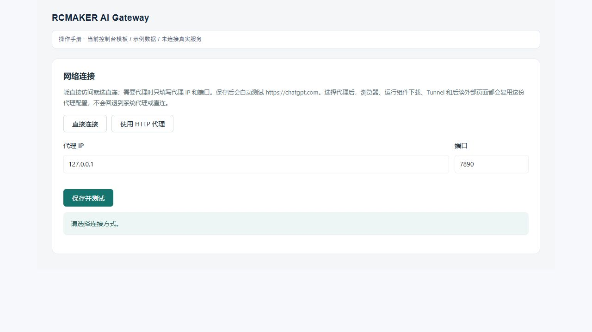
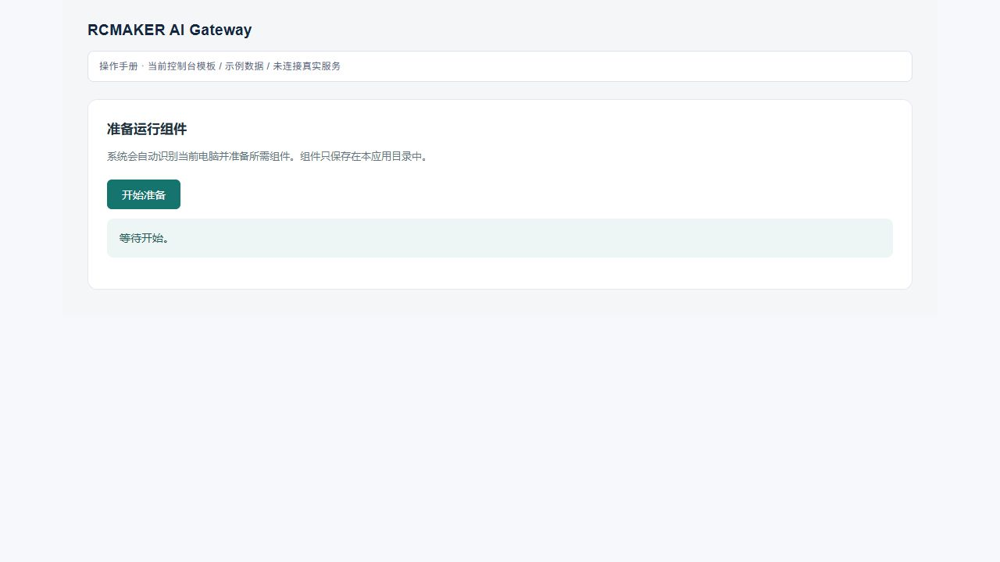
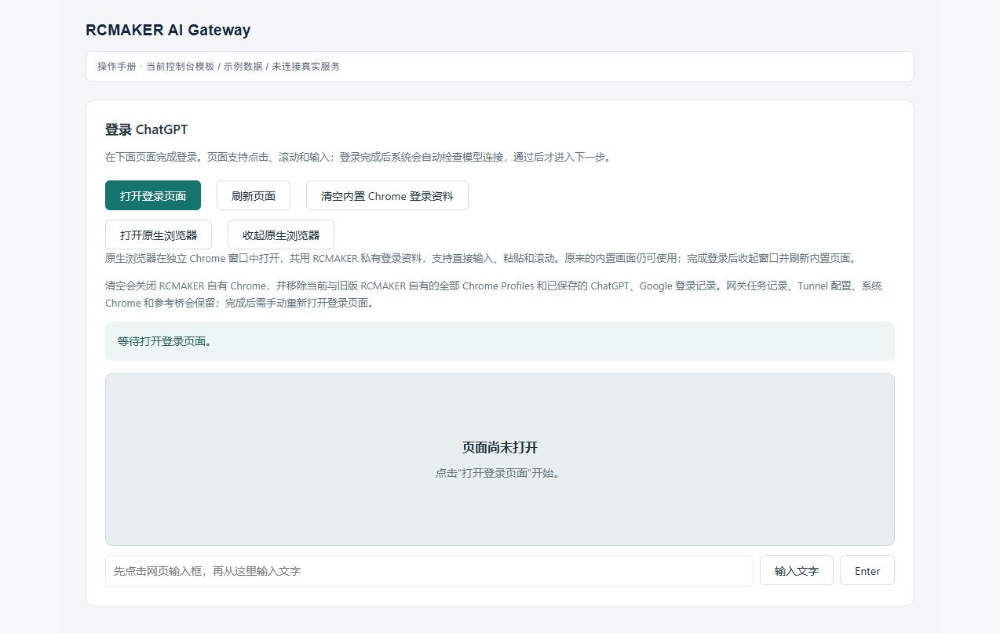
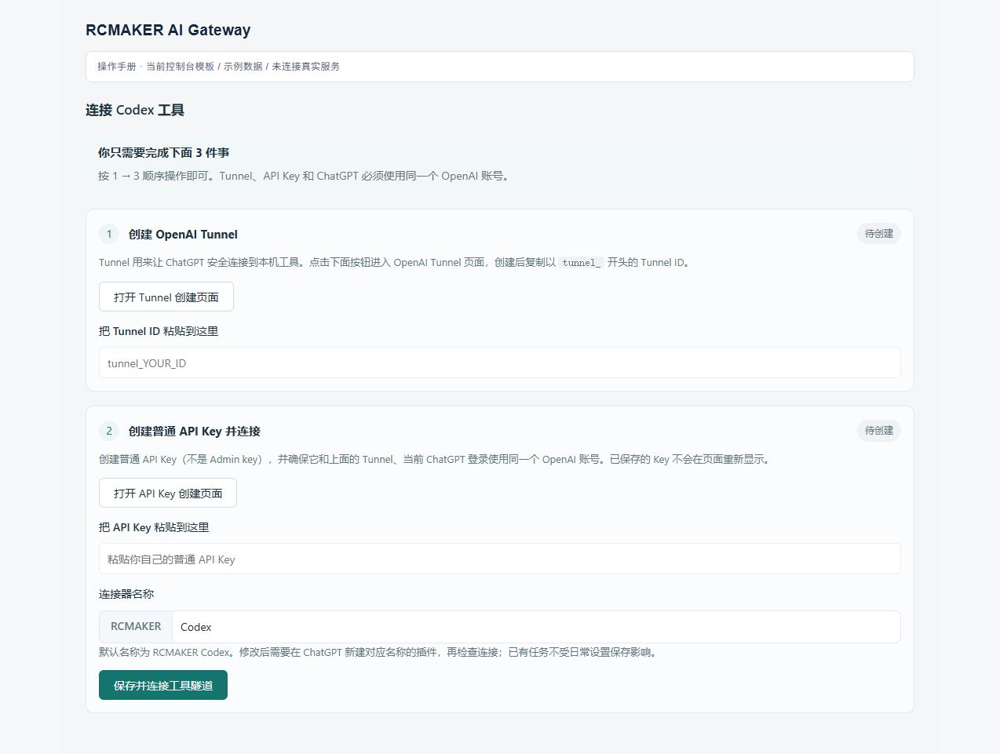
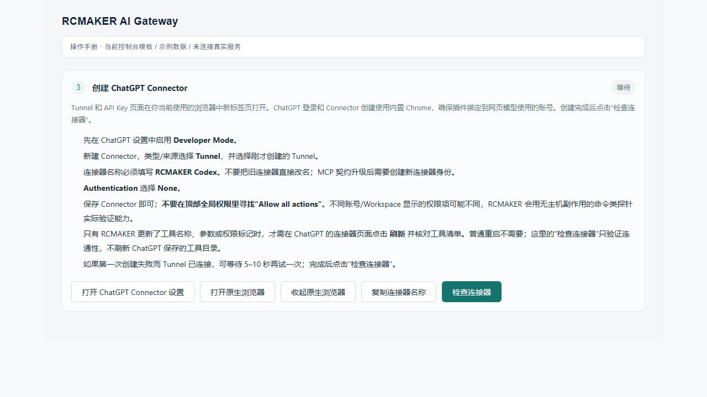
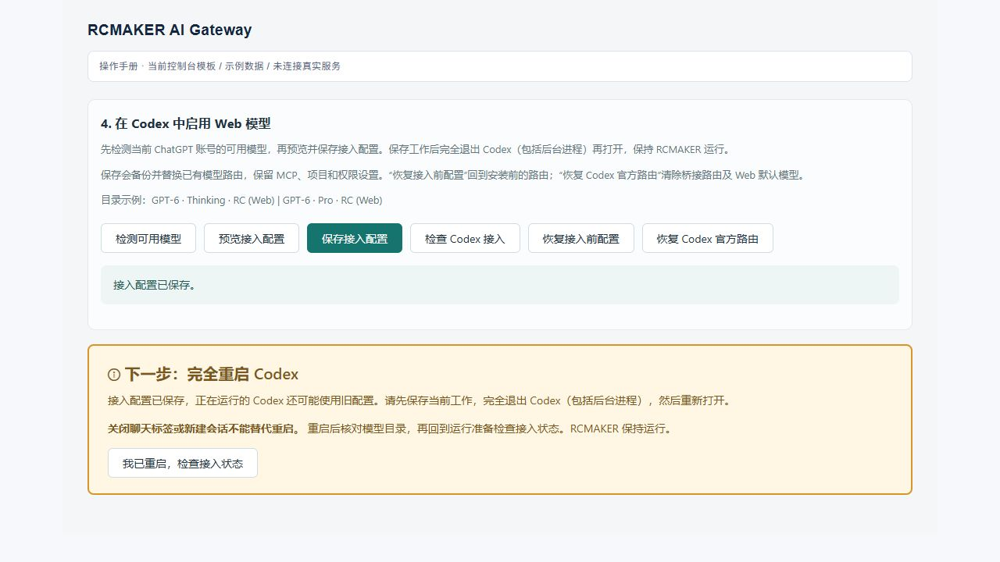
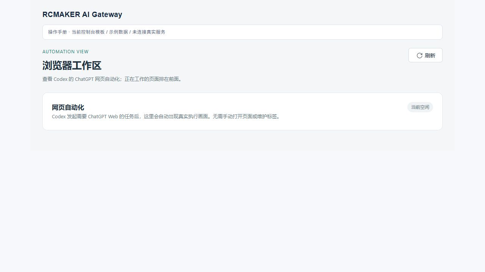
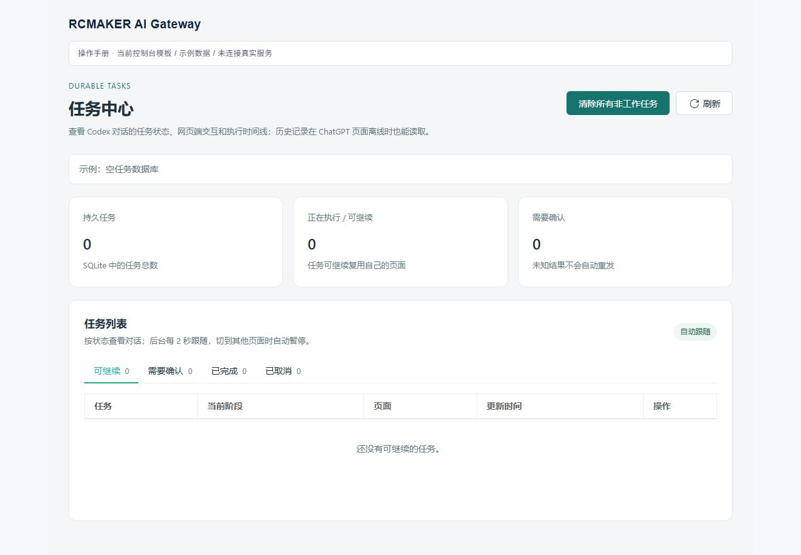
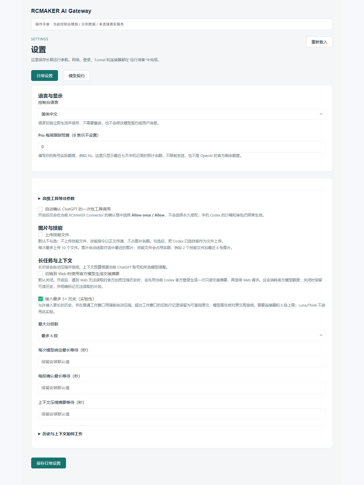

# RCMAKER Codex Gateway · 用户操作手册

**简体中文** · [English](user-guide.en.md) · [项目介绍](../README.zh-CN.md) · [常见问题](faq.zh-CN.md)

第一次使用：**选择安装方式 → 完成运行准备 → 接入并重启 Codex → 发起任务**。已经配置过的用户，可以直接查看日常操作或故障速查。

| 你现在要做什么 | 从这里开始 |
| --- | --- |
| 了解需要准备什么 | [1. 开始前准备](#before-start) |
| 下载程序直接使用 | [2. 二进制安装](#binary-install) |
| 使用 PHP 源码运行 | [3. 源码安装](#source-install) |
| 配置网络、组件与登录 | [4. 运行准备](#setup) |
| 创建连接器、接入 Codex | [5. 工具连接与 Codex 接入](#connect-tools) |
| 发起任务、查看进度和记录 | [6. 首次任务](#first-task) · [7. 日常操作](#daily-use) |
| 调整语言、上下文和用量设置 | [8. 设置说明](#settings) |
| 更新、恢复或解决故障 | [9. 升级与恢复](#upgrade) · [10. 故障速查](#troubleshooting) |

操作入口按 **2026 年 10 月 10 日**的项目文件核对。配置截图使用控制台模板和示例数据，仅说明按钮位置；真实连接状态、账号权限和模型列表以你的界面为准。

<a id="before-start"></a>

## 1. 开始前准备

### 分清三个操作窗口

| 窗口 | 用途 |
| --- | --- |
| **Codex** | 打开项目、发送需求、处理授权、查看文件变更与最终结果 |
| **RCMAKER 本机控制台** | 完成配置，查看运行状态、任务记录和网页实况 |
| **RCMAKER 私有 Chrome** | 登录 ChatGPT、创建该账号使用的插件；任务网页由网关管理 |

私有 Chrome 的内嵌画面与“打开原生浏览器”窗口共用登录资料，和你日常使用的系统 Chrome 分开。**只在系统 Chrome 登录 ChatGPT，不等于网关已登录。**

### 准备账号、网络与安装目录

使用已安装 Codex 的电脑，并准备一个自己有写入权限的安装目录。首次配置需要联网下载运行组件、登录 ChatGPT 和连接工具隧道；二进制包含 PHP，但不意味着安装后可以完全离线使用。

准备具有所需模型和自定义 MCP 插件权限的 ChatGPT 账号，以及有相应 Tunnel 权限的 Platform 账号/工作区。按控制台引导，使用与私有 ChatGPT 登录相对应的账号配置 Tunnel 与普通运行 API Key；Codex 桌面端登录可以不同。**同一邮箱不等于拥有所有工作区权限**，Tunnel 的组织/工作区关联和创建、使用权限需分别核对，见 [OpenAI 官方说明](https://developers.openai.com/api/docs/guides/secure-mcp-tunnels)。

<a id="install"></a>

| 安装方式 | 适合谁 | 是否需要自行安装 PHP / Composer |
| --- | --- | --- |
| [二进制](#binary-install) | 直接使用网关 | 不需要 |
| [源码](#source-install) | 参与开发、自行维护运行环境 | 需要 |

**二选一即可。** 两种方式启动后都从[运行准备](#setup)继续。

<a id="binary-install"></a>

## 2. 二进制安装

### 2.1 自动安装

**Windows x64：**在 PowerShell 中执行。

```powershell
irm https://raw.githubusercontent.com/runchance/rcmaker-codex-gateway/master/.github/scripts/install.ps1 | iex
```

**Linux / macOS：**在 Bash 中执行，支持 x64 和 ARM64。

```bash
curl -fsSL https://raw.githubusercontent.com/runchance/rcmaker-codex-gateway/master/.github/scripts/install.sh | bash
```

脚本下载最新正式版并校验压缩包及可执行文件的 SHA-256。Windows 脚本需要系统 `tar.exe`；Linux/macOS 脚本会检查下载、解压和校验工具，缺少时按错误提示补齐后再运行。脚本源码：[Windows](../.github/scripts/install.ps1) · [Linux/macOS](../.github/scripts/install.sh)。

**安装位置：**当前目录已有程序时原位更新；否则使用当前目录下的 `rcmaker-codex-gateway/`。首次在交互终端安装时可输入其他目录，非交互运行使用默认值。最终位置以脚本输出为准。

<details>
<summary>需要指定目录？展开查看命令</summary>

在执行安装脚本前设置目录。以下只是路径示例，请换成自己的目标位置。

Windows：

```powershell
$env:RCMAKER_INSTALL_DIR = 'D:\Apps\RCMAKER-Gateway'
irm https://raw.githubusercontent.com/runchance/rcmaker-codex-gateway/master/.github/scripts/install.ps1 | iex
```

Linux / macOS：

```bash
export RCMAKER_INSTALL_DIR="$HOME/Apps/rcmaker-codex-gateway"
curl -fsSL https://raw.githubusercontent.com/runchance/rcmaker-codex-gateway/master/.github/scripts/install.sh | bash
```

要安装到当前目录，可将该变量设为 `.`。相对路径以执行命令时的目录为基准。Bash 的变量必须先 `export`，不能只把变量赋给管道左侧的 `curl`。

</details>

### 2.2 手动下载安装

打开 [Releases](https://github.com/runchance/rcmaker-codex-gateway/releases/latest)，在发行附件中选择与机器匹配的压缩包；直接使用的用户不要下载 GitHub 自动生成的 **Source code** 包。

| 机器 | 发行包文件名后缀 |
| --- | --- |
| Windows x64 | `windows-x86_64.zip` |
| Linux x64 | `linux-x86_64.tar.gz` |
| Linux ARM64 | `linux-aarch64.tar.gz` |
| macOS Intel | `macos-x86_64.tar.gz` |
| macOS Apple Silicon | `macos-aarch64.tar.gz` |

解压到有写入权限的目录，保留包内许可证和配置示例。无需提前建立 `data/`，也不要复制其他用户的登录资料。发行文件以所选 Release 实际附件为准。

### 2.3 启动程序

安装脚本**不会自动启动**网关。进入脚本输出或手动解压的目录：

| 系统 | 启动方式 |
| --- | --- |
| Windows | 双击 `rcmaker-codex-gateway.exe`，或在 PowerShell 执行 `.\rcmaker-codex-gateway.exe` |
| Linux / macOS | 在终端执行 `./rcmaker-codex-gateway` |

手动解压后若缺少执行权限，可先运行 `chmod +x ./rcmaker-codex-gateway`。系统提示缺少浏览器运行库或图形环境时，按具体报错准备环境；对应平台的二进制不包含所有操作系统组件。

保持运行窗口开启，在同一台电脑打开 **[本机控制台](http://127.0.0.1:28910/)**，继续[第 4 节](#setup)。默认 `data/` 位于可执行文件旁，首次使用时自动创建。

<a id="source-install"></a>

## 3. 源码安装

**已经采用二进制的用户跳过本节。**

### 3.1 准备 PHP 环境

准备 Git、Composer 和 PHP 8.1–8.5 的 CLI 环境。项目发行构建使用 PHP 8.5，扩展配置包括 `curl`、`openssl`、`zip`、`mbstring`、`pdo_sqlite`、`sqlite3`、`sockets`、`sodium`，见[构建配置](../.github/workflows/release.yml)。Unix 常驻进程所需扩展也应按运行框架要求启用。

可先参照 [RCMAKER 环境准备](https://rcmaker.runchance.com/doc/#/md/quick-start?id=_1-%E5%87%86%E5%A4%87%E7%8E%AF%E5%A2%83)，再在准备运行网关的终端检查：

```bash
php -v
php -m
composer --version
```

终端中的 PHP 必须具备所需扩展；仅在网站/FPM 使用的另一套 PHP 中启用扩展无效。

### 3.2 获取源码并启动

```bash
git clone https://github.com/runchance/rcmaker-codex-gateway.git
cd rcmaker-codex-gateway
composer install
php index.php start
```

已经下载源码时，在其根目录从 `composer install` 开始。不要跳过 Composer 的安装脚本；项目通过它应用所需的框架兼容补丁。

默认配置可以直接启动。需要覆盖部署参数时，参考根目录 [`.env.example`](../.env.example) 创建 `.env`；已有 `.env` 不要覆盖。默认数据目录是项目根目录下的 `data/`，不是 PHP 可执行文件旁。

保持进程运行，打开 **[本机控制台](http://127.0.0.1:28910/)**。后续配置与二进制相同。

<a id="setup"></a>

## 4. 运行准备：网络 → 组件 → 登录

新安装默认英文，可在初始化向导右上角选择简体中文。完成后也可使用顶部语言菜单或 **Settings → Console language**。语言切换立即保存，不需要重启。

首次进入控制台会显示初始化遮罩，依次完成**网络 → 组件 → 登录 → 隧道 → 连接器 → Codex 接入**。只显示当前步骤的操作，其他页面暂不可切换。每步保存成功后记录进度，刷新或重启后从未完成处继续；最后点击“进入控制台”。

已完成初始化时，运行准备显示连接状态卡片，可单独管理某项配置。


*控制台示意使用演示数据；账号、模型和用量以实际检测为准。*

### 4.1 设置网络

点击**设置网络**。可以直连时选择**直接连接**；需要代理时选择**使用 HTTP 代理**，填写主机和端口，点击**保存并测试**。

| 字段 | 填写方式 |
| --- | --- |
| 代理 IP / 主机 | 如 `127.0.0.1`，不带 `http://`、用户名或路径 |
| 端口 | 代理软件实际提供的 HTTP CONNECT 端口 |
| 代理认证 | 展开“代理认证（可选）”填写用户名和密码；已有密码留空保留 |

保存的网络配置供应用浏览器、组件下载和工具隧道使用，不修改系统代理。仅支持 SOCKS 的端口不能当作 HTTP 端口填写。

在第一步“网络设置”或“网络与代理”页面选择浏览器时区，无需修改配置文件。默认自动跟随代理出口；也可搜索城市手动选择（例如东京 `Asia/Tokyo`），或选择“使用电脑时区”。自动模式在直连时沿用电脑时区。保存并应用新版本会重新初始化正在运行的私有 Chrome，保留登录资料；若有网页任务或浏览器操作正在进行，设置会保存为待应用版本，等待完成后再应用。尚未启动浏览器时，新设置在下次启动生效。之后遇到时区问题，可返回第一步调整并重新应用。

自动检测通过浏览器选定的 HTTP 代理访问 `ipwho.is`，失败后尝试 `ipapi.co`，不发送登录信息或聊天内容。若代理按域名分流，请确保查询站点与 ChatGPT 使用相同出口，或手动选择出口所在地时区。两个查询都失败时会明确报告 `BROWSER_TIMEZONE_LOOKUP_FAILED`，不会猜测时区或绕过代理。时区在登录页、任务页和连接器检查页执行脚本前应用，不修改 Windows 时区。时区一致并不保证解决网站的 `Model not found`，仍需核对实际模型请求结果。

时区只在每次浏览器初始化时解析一次，新页面沿用该结果。页面控制暂时失败时，网关保留正常页面的时区，重新检查失败的控制会话；恢复前新的网页请求可能返回未就绪。`BROWSER_TIMEZONE_APPLY_FAILED` 表示时区控制流程异常，不一定是时区名称错误，运行日志会记录具体 CDP 方法和错误。自动恢复不会刷新页面、重发任务或重放工具。

**完成标志：**网络检查通过。目标网站返回 HTTP 403 与代理拒绝建立隧道是不同情况；网络可达也不代表账号已登录，详见[网络 FAQ](faq.zh-CN.md#network)。

<details>
<summary>查看网络配置截图</summary>



截图端口仅为示例，使用自己的代理端口。

</details>

### 4.2 准备运行组件

浏览器组件和工具连接组件分别准备。工具连接组件由后台进程安装，控制台只登记并观察同一项准备工作；重复点击、刷新或重新打开会复用未完成记录，重启后先核验已有文件。工具组件下载有30分钟总时限、15秒连接时限，以及连续120秒低于每秒一字节的低速保护，校验与原子发布规则保持。观察超时或请求中断不会被当作安装失败，也不会自动重复提交；可以稍后查看状态。明确的后台下载、校验或版本错误仍会显示。控制台中英文均适用。

点击**准备运行组件 → 开始准备**，等待私有 Chrome 与工具隧道组件准备完成。先设置网络，再下载组件。

浏览器压缩包下载总时限为两小时，连接时限为 15 秒；连续两分钟传输速度不足每秒一字节时提前失败。控制台按后台安装预算等待同一个命令，进度到 60% 不会触发超时。慢速下载期间保持工作进程心跳，即使服务器没有提供文件总大小也会更新。失败的未完整下载文件会清理；重试前先检查报错和网络设置。

**完成标志：**运行组件卡片显示就绪。下载失败先查网络、磁盘空间与完整报错，不要转去重复创建连接器。

<details>
<summary>查看运行组件截图</summary>



</details>

### 4.3 登录 ChatGPT

点击**登录 ChatGPT → 打开登录页面**，完成账号登录。内嵌画面不方便输入或滚动时，点击**打开原生浏览器**，在独立的私有 Chrome 窗口操作。

登录后控制台自动检测账号并同步模型，无需重新点击打开页面。可以用**收起原生浏览器**收起窗口；画面本身未更新时使用**刷新页面**。

**完成标志：**账号识别成功、模型检查完成。接着进入工具连接。

<details>
<summary>查看登录与原生浏览器按钮</summary>



</details>

**“清空内置 Chrome 登录资料”是重置操作。** 它会删除本应用保存的 ChatGPT/Google 登录和 Profiles，之后需要重新登录。普通刷新不要使用这个按钮；确需换号重置时先结束任务。

确认清空后立即进入登录步骤。重新登录并同步模型后，会自动检查已保存的连接器；失败时按提示手动检查。任务和网关设置保留，不需要重新填写已保存的 Tunnel ID 和 Key。

<a id="connect-tools"></a>

## 5. 工具连接与 Codex 接入

初始化时进入“隧道”和“连接器”步骤；日常管理从**运行准备 → 管理连接**打开。顺序是：**创建 Tunnel → 保存 Key 并连接 → 创建 ChatGPT 插件 → 检查连接器 → 接入 Codex**。

### 5.1 创建 Tunnel 并连接

点击**打开 Tunnel 创建页面**，创建 Tunnel 并复制 `tunnel_...` 标识；再点击**打开 API Key 创建页面**，创建有对应权限的**普通运行 API Key**，不是 Admin key。

这两个按钮在你正在使用的控制台浏览器中新开标签。检查该浏览器的登录账号，避免与私有 ChatGPT 账号、目标工作区混淆。

| 本机字段 | 填写内容 |
| --- | --- |
| Tunnel ID | 刚创建的 `tunnel_...` 标识 |
| API Key | 有权使用该 Tunnel 的普通运行 Key；已保存时可以留空 |
| 连接器名称 | 固定前缀 `RCMAKER` 加自定义后缀，默认 `RCMAKER Codex` |

点击**保存并连接工具隧道**，等待已连接，再继续下一步。正常首次保存会让隧道开始连接，无需为这一步重启网关。



### 5.2 创建 ChatGPT 插件并检查

连接器步骤提供“网页对话模式”，默认仍是临时对话。若能正常读取临时页面却找不到插件，会再验证普通对话；只有普通页面完成真实连接器回执验证后才自动保存为普通模式，并在控制台说明。登录失败、网络超时本身不会触发切换，也可在该步骤重新保存临时模式。

普通模式下，每个新任务绑定自己的网页对话及账号／工作区。关闭标签或重启 RCMAKER 后重新打开这条对话，只发当前需求、必要的新指令和准确回执；正常压缩、插话、切换模型和全量重发设置都不重发其历史。网页仍显示停止按钮时继续等待，连接中断提示本身不触发恢复。停止按钮消失后，结合当前轮的重试按钮或发送按钮与明确报错判断异常；空输入框显示语音按钮不代表仍在生成。异常时先原生重试，恢复后在原页发送短继续契约；仍异常才刷新原对话并短继续，刷新续做后再失败才隔离旧页，用完整上下文及准确工具回执初始化新普通对话。新页首次消息及账号归属确认后，才将原任务绑定到新对话 ID。已受理工具先结清；重试期间保留旧回执查询，新增工具执行等到准确继续契约被接收后再开放。结果未知、账号／页面归属不明时不自动重放；每步保存恢复意图，避免丢失回执或重启后重复发送。确认网页记录删除，或本地任务被手动／自动清理，也可按 Codex 历史初始化新对话。本地清理不会删除 ChatGPT 历史中的旧记录。

普通对话及普通模式的连接器探针会保存在 ChatGPT 历史中。切换到普通模式后，已有临时任务下次续发时也会用完整可读上下文初始化独立的普通对话；已受理工具先结清并保留准确回执，旧临时页隔离后再发送。绑定成功后只发送新增需求。已有普通绑定继续保留，不因模式设置来回切换而丢失。仍使用临时模式的任务，原有插话、压缩、恢复与全量重发设置继续有效。

普通对话当前回答明确显示“已停止思考”，且停止按钮消失、输入区恢复空闲控件时，网关会在已绑定原页发送短继续契约。连续三次已送达的继续消息仍异常停止、期间没有新的工具进展，才隔离旧页，用完整上下文及准确工具回执恢复到新普通对话。正常完成或用户主动停止不会触发该恢复；有新用户指令时优先交接新指令，在途工具仍先结清。此规则不改变临时对话和压缩流程。

普通对话经过多次续发后，最新短消息不必重复首条消息中的令牌。网关以绑定的对话 ID、当前页面文档、重新验证的账号及任务归属确认原页，再按原有插话／续发流程发送新增需求；校验期间页面变化则重新核验。

普通聊天中，尚未发送的新需求找不到准确连接器时，网关会先刷新绑定的原对话一次，重新验证账号后再查找。原对话 ID、当前需求和工具回执均保留。刷新后仍缺少连接器，不会仅凭这一点换新聊天或进入临时对话重建，而是保留原对话并报告连接器问题。

点击**打开 ChatGPT Connector 设置**，或该区域的**打开原生浏览器**，使用私有 Chrome 的账号创建插件。

当前官方入口为 **Plugins → ＋ → Add custom MCP server**。账号仍使用 Apps / Developer Mode 界面时按其实际入口操作；需要开发者模式或工作区授权时，先完成对应要求。参见[官方创建步骤](https://developers.openai.com/api/docs/guides/custom-mcp-server)。

| ChatGPT 字段 | 本项目填写方式 |
| --- | --- |
| Name / 名称 | 使用“复制连接器名称”得到的完整名称，如 `RCMAKER Codex` |
| Connection / 来源 | 选择 **Tunnel**，并选中上一步的 Tunnel |
| Authentication / 身份验证 | **No authentication / None** |

阅读页面提示后创建插件，并完成界面要求的安装/连接操作。回到 RCMAKER，点击**检查连接器**。

首次检查会真实验证 MCP 权限回执，并绑定当前网页账号保存。之后的检查及正常重启，只确认私有浏览器中能找到唯一、准确匹配的连接器，不再向模型发送探针消息。连接器、账号或连接配置变化后重新进行首次验证；清空私有登录资料也会移除该记录。旧版本没有保存验证记录对应的账号，升级后需要补一次，之后即可复用。名称检查表示网页中连接器可用，不代表本次又做了一轮实际 MCP 连通测试。

读取网页账号遇到短暂网络失败或限流时，检查会在同一检查页内退避等待，最多读取四次、共用 90 秒账号确认窗口；不会刷新任务页或重复发送探针。登录失效、账号变化或连接器名称不符仍会拒绝通过。失败诊断仅记录原因分类、HTTP 状态及等待时间，不保存登录凭据。

**完成标志：**隧道和连接器检查均通过。Tunnel 不在列表中时，先核对组织/工作区关联与权限；插件创建成功但检查失败时，按[连接器 FAQ](faq.zh-CN.md#connector)排查。

<details>
<summary>查看连接器检查清单</summary>



</details>

已有安装保留原连接器名称，不必改成默认值。修改后缀后应新建名称匹配的插件再检查。普通重启不用重建插件；发行说明要求更新工具定义时，在 ChatGPT 点 **Refresh / Refresh tools**，再回本机检查连接。两者不是同一个操作。

<a id="codex-integration"></a>

### 5.3 保存 Codex 接入并完整重启

在同一配置弹层找到**在 Codex 中启用 Web 模型**：

1. 点击**检测可用模型**，等待当前网页账号检测完成。
2. 点击**预览接入配置**，核对目标配置与路由变更。
3. 点击**保存接入配置**。

保存会备份并替换模型路由，保留无关的 MCP、项目与权限配置。从其他网关切换时，先核对预览中的旧路由。



> **等待 RCMAKER 启动窗口显示“准备就绪”，然后完全退出 Codex，包括后台进程，再重新打开。保持 RCMAKER 运行。只关闭聊天标签或新建聊天不能替代重启。**

**配置接入标志：**Codex 配置中存在 `# RCMAKER BEGIN` 和 `# RCMAKER END` 两条实际注释，即显示已接入。忽略后面的标识值，不要求与当前安装记录或 URL 后缀一致；字符串里的示例文字和单独的压缩标记不计为接入。检测不重写配置。

此检查只代表最后的 Codex 步骤完成。前面任一步未通过，初始化遮罩仍会打开并继续对应步骤。

完整重启 Codex 后，应看到以 **RC (Web)** 结尾的模型。第一次真实任务用于确认工具通信，不是解锁控制台的条件。没有就绪提示时，回到运行准备处理尚未完成的配置。

<a id="first-task"></a>

## 6. 发起并核对首次任务

在 Codex 打开要处理的项目，选择检测通过的 **RC (Web)** 模型。Thinking 条目提供可用推理档位；Pro 可用时选独立的 **Pro · RC (Web)** 条目。具体家族名称以当前检测结果为准。

先发送一个只读、容易核对的请求：

```text
读取这个项目的 README 和目录结构，说明如何启动，以及缺少哪些配置。
这次先不要修改文件，回答要基于实际读取结果。
```

| 查看位置 | 应看到什么 |
| --- | --- |
| Codex | 实际工具调用与读取结果，随后给出回答 |
| 浏览器工作区 | 自动创建的 ChatGPT 任务页面 |
| 任务中心 | 对应任务的消息、工具回执与状态 |

通过后再提出具体开发需求，并在 Codex 中处理需要的授权。文件变更看 diff，验证结果看真实输出，不能只凭最后一句“已完成”判断。

<a id="daily-use"></a>

## 7. 日常操作

### 控制台标签与自动刷新

打开的页面标签和当前页面会记住。切回运行准备或浏览器工作区时自动读取最新状态，保留页面滚动和未保存的表单。刷新整个浏览器不保留未保存草稿。

复制、输入、滚动或拖动时，自动重绘暂缓；显式点击的操作正常执行。非活动页面暂停轮询，返回后继续。模型按家族分组，重复官网提醒只显示一次；设置中的上下文容量以表格显示，详细解释可以展开阅读。

### 启动、插话与停止

日常启动先打开 RCMAKER，等运行条件恢复，再使用 Codex；已保存的登录和连接配置会复用，不必每次创建插件。修改过接入或模型目录后，按控制台提示完整重启 Codex。

工具任务的公开阶段文字会在网页观察稳定后，以进展消息传给 Codex；最后一个普通段落不必等下一段或工具调用出现。段落增长只补发新增文字，工具换轮后按持久记录去重。进展消息不代表任务完成；最终回答、准确工具回执和压缩仍各自通过原有校验。网页渲染或浏览器读取缓慢时仍可能有延迟。

支持 Code Mode 的 Codex 运行时可在单次原生 `exec` 内，并行处理独立读取、查询或测试；外层工具请求仍遵循客户端的串行设置。模型按实际依赖决定如何分组，不保证所有调用都并行。存在先后依赖、修改同一文件、共享浏览器操作和审批仍须串行；每项结果独立保留，部分失败不重跑整批，不能跨任务借用工具或页面。旧客户端或未提供原生编排入口时继续使用直接工具。

Code Mode 的嵌套发现与执行均排除其他 Codex 桥接连接器，包括其他集成名称下的 `codex_exec`、`codex_tool_call` 等操作，避免绕过本任务网关进入另一条桥接链。本机命令应使用原生 `exec_command`；普通原生工具和已授权的其他应用能力继续可用。

普通对话中，原生 `exec` 返回 `Script running with cell ID …` 仍表示脚本待完成，外层调用成功交付不等于脚本完成。网关保留准确输出，并提供本任务的续接入口，调用当前原生 `wait` 等待该脚本；重试复用同一等待调用，回执确认丢失则先重新交付原结果，不重跑脚本或已成功的批次成员。未提供原生等待工具的运行时保持原行为。因页面恢复、新用户指令或压缩而暂停目录查询时，返回真实暂停说明，不再误报“内层工具目录无效”。

任务进行中，直接在**同一条 Codex 对话**补充要求或提问。相关修改作为任务引导；需要停止或替换目标时明确说明。在**设置 → 长任务与上下文 → 插话时全量重发上下文**选择临时模式的发送方式，默认关闭：确认原页停止后，仅发送新增需求、更新的指令和必要工具回执，保留已完成进度。开启后沿用临时模式原有全量发送流程。普通模式始终复用绑定的网页对话，不受此开关影响。

每次插话都要求模型先根据已提供的信息判断本次意图，再用你的语言简短回应并说明紧接着要做什么，然后才开始调查或后续动作。首次回应应是普通可见文字，思考摘要、状态标题或工具调用不能代替；网页搜索、连接器发现及结果查询也应在回应之后。需要调查的问题，先说明要核实什么，不等调查结论才回应，也不猜测尚未确认的事实；调查后再给有依据的回答，不把提问当成修改文件或任务目标的授权。已有依据的简短答案或无需后续动作的停止报告可以直接作为回应。获准继续任务时，先复用已有准确工具回执；缺失时用当前有效能力通过连接器或原文读取查询原调用，仍在执行就等待，未知或失败先核实，不因插话重新提交已受理调用。

续发也按先判断意图、再回应、后执行的顺序处理。上轮已经结束、失败或手动停止后，单独的讨论问题只调查并回答后结束；只有本次意图要求继续或调整任务时才启动后续工作，历史尚有未完成事项本身不等于要求续作。执行中的插话则不同：回答侧问后继续仍适用的原任务，不能只因侧问已答完就宣布整项任务完成。参考附件本身也不等于要求按图修改。

已验证普通对话中的新用户续发使用精简契约：先判断意图，在调用工具前用可见文字简短回应，再按该意图行动。询问或讨论只做必要调查并回答；明确停止则停止新步骤；要求执行、继续或调整任务时，按授权范围工作，并在关键阶段简短说明当前判断、下一步和已验证结果。历史只在缺少事实时按需查询。这些是公开进度说明，不要求输出内部推理。用户自定义续发模板保留并补充限定说明；临时对话、执行中插话及压缩契约沿用原路径。

插话的两种发送方式及手动停止后的续发都遵循先判断意图的顺序。调整目标、范围、优先级或约束时，模型简要说明调整后继续剩余步骤，保留仍适用的成果。执行中的讨论或侧问回答后，继续仍适用的原任务；上轮结束后的独立讨论不自动重启任务。明确停止时，不再启动新步骤，并按真实进度说明已完成、未完成及仍在结清的工具。明确取消、更换目标或仅调查并回答时，遵守最新边界。契约不逐轮累加，也不改变工具回执、上下文预算或压缩机制。

停止任务在 Codex 操作，再查看任务中心状态。准备关闭网关时，先结束任务和等待中的授权，再在启动终端按 **Ctrl+C**。不要通过直接关掉执行中的网页来代替任务取消。

Codex 与 RCMAKER 使用同一配置的 Codex 目录时，网关会将明确的手动中断记录匹配到具体会话和回合。手动停止和插话都保留已经接受的工具调用，包括队列中的调用及其准确回执，等待期间暂停新增操作。插话排队时，网关会先尝试停止已确认归属的网页生成，让已受理的本机工具继续完成；准确回执结清后再发送新增需求。单独的手动停止仍先等待工具和回执交付，再完成网页停止。此时续发可以衔接原任务，不撤销原调用的能力、不重放宿主操作。明确取消整个任务仍是独立操作。

临时模式之后在原 Codex 对话继续也受上述开关控制。该设置只控制正常续发；重启后无法验证原页、原页缺失或网页确实异常时，仍沿用完整上下文和准确工具回执的恢复流程，发送前隔离旧页。普通模式重新打开已绑定的网页对话，按第 5.2 节处理，不因标签丢失重发历史。短暂读不到停止状态不会单独触发换页或全量重发，网关会在本回合原有时限内继续确认。不能确认的工具执行结果不会自动重放。读取不到本地会话记录时，不会据此擅自停止网页。设置只影响之后接收的请求，不改变已排队请求。

手动停止时，浏览器控制读取超时不等于网页或控制会话失效，也不代表停止成功。网关保留会话，并在点击结果不确定时先读取原页状态；只有确认仍在生成且归属未变，才允许再次尝试停止。控制会话确实失效时重新挂接，原任务和工具回执保留。

输入内容后，发送按钮可能暂时禁用。普通消息与附件消息均在最长 60 秒、且不超过原任务截止时间的准备窗口内等待，稳定性复核沿用同一个窗口。等待不重复输入或发送；取消、页面归属变化或到期时，旧回调不能继续发送。

**Codex 压缩不等于 Web 模型上下文已满。** 压缩先等待已受理工具回执结清，停止旧页生成，再发送独立的摘要请求。检查点完成后，若原页面、任务归属及检查点仍能精确验证，则继续使用同一网页，只发送继续执行指令与新增内容，不重发已经保留的历史。临时摘要指令到此结束，任务继续处理剩余步骤；连续多次压缩同样适用。页面丢失、无法验证或真实容量／请求错误仍按原恢复流程处理。正在生成摘要时不能混入普通任务续发。

每次压缩后的首次恢复执行，模型应先用你的语言简短说明已确认的进展和紧接着要做的步骤，再继续调用新工具；不能只说“继续”后结束，也不能编造已完成的成果。普通工具回执和之后的续发不重复这条恢复说明，新的仅讨论、暂停或目标调整要求仍优先。该要求不增加重发、额外工具调用或完成校验门槛。

同一份只读压缩请求即使换了临时会话 ID，在接入、模型、档位、分支和完整历史一致时，也会接回正在生成的摘要或返回已有结果，不另开页重复发送。失败响应保留真实错误；只有通过完整历史、未发布摘要及无宿主操作等恢复校验，才能安排一次受控恢复。升级前已因私有摘要草稿变化而失败的记录也按此核验，原错误记录和已完成工具回执不会被改写。

网页单独显示“连接已断开／正在等待完整答复”时，不据此判定页面失效或任务结束。网关继续观察工具回执、生成状态和发送按钮；按钮恢复发送状态后，还要确认工具已结清和回答已稳定，或出现实际请求错误，才能结束本轮或进入恢复。

### 浏览器工作区

最多保留五个任务页面，标记活动/非活动；任务页面由网关自动管理。容量满时等任务释放页面，或关闭界面允许关闭的非活动页。**关闭网页与删除任务记录是两个操作。**

不要在自动化使用的 ChatGPT 任务页面直接输入另一份需求；从 Codex 发送，才能保留任务关联。

<details>
<summary>查看浏览器工作区与任务中心截图</summary>





</details>

### 查看完整发送原文

进入**任务中心 → 对应任务 → 时间线**，查看消息、工具结果、上下文发送与压缩决策。展开全量消息记录，可以**复制或下载**实际发送的契约和上下文，用于核对附件、插话和异常。

“记录了发送意图”不等于“网页已接收”；排查时结合回执和后续状态。下载文件可能包含项目内容，分享前先脱敏。

### 清理任务

使用任务中心的**清除所有非工作任务**，按确认提示清理。运行中、工具执行中及等待审批的任务会跳过；清理不针对项目源文件和 Codex 聊天。仍被引用的检查点或附件可能保留。删除释放的数据库空间供后续写入复用，运行期间不会自动整库压缩，见[清理 FAQ](faq.zh-CN.md#cleanup)。

数据库日志回填由独立维护进程执行，浏览器和 API 进程提交数据时不再顺带整理积压日志。维护使用 `PASSIVE` 检查点，遇到活跃读写就保留尚未回填的记录，后续继续；不强制结束其他进程的读取或等待它们释放锁。数据提交仍保持完整同步落盘。已经安全回收的日志文件只保留至多 16 MiB 的复用空间，这不是尚待回填日志的大小限制。维护与业务仍共享磁盘，慢磁盘或业务本身的长写事务仍可能影响响应。

<a id="settings"></a>

## 8. 设置、上下文与用量

首次使用保留默认值即可。**日常设置**调整运行偏好；**模型契约**编辑发送给网页模型的模板，普通用户无需改动。

升级会自动更新默认契约。已在控制台自定义并保存的契约会原样保留，不会自动合并新版默认文案；需要时可手动调整或恢复默认。压缩后的首次执行进展提示由网关在模板之外补充，自定义模板同样适用，但应检查其中是否有相反要求。更新代码加载后作用于后续请求，不会修改已发送到网页的内容。

| 日常设置 | 怎么理解、何时修改 |
| --- | --- |
| 控制台语言 | 中英切换立即保存，不翻译用户消息或模型契约 |
| 接入最多 3× 历史（实验性） | 新安装默认开启，需要连接器与六段上限；不扩大模型自身窗口，部分模式不适用 |
| 最大分段数 | 新安装默认最多六段；实际按上下文与预算决定，不是每次固定发六条 |
| 每次模型响应最长等待 | 针对一次模型响应；收到工具结果后重新计时，不是整个项目总时长 |
| 每段确认 / 压缩摘要等待 | 分别控制上下文分段和摘要的等待；不要把两者混为一项 |
| 官方模型交接摘要 | 默认关闭；开启后可为无法直接读取的官方加密历史生成可读摘要，可能使用官方额度 |
| 上传技能文件 | 默认通过正文传递技能；勾选后技能文件与近期图片共用最多 10 个上传名额 |
| 自动确认 ChatGPT 一次性工具调用 | 仅处理当前连接器的单次确认，不取消 Codex 沙箱和本机审批 |
| Pro 每周跟踪预算 | 只用于本机预计余额，不会限制发送，也不是官方剩余额度 |

设置保存后，新请求使用新值，已开始任务保留原预算和等待设置。模型目录已更新而 Codex 仍显示旧值时，完整重开 Codex。

<details>
<summary>查看设置截图</summary>



</details>

### 分段、压缩与 Pro 的区别

**分段**把较长历史分批传入；**压缩**生成供后续继续工作的摘要。两者都会增加等待，但不等于失败。长历史不仅包含你输入的几句话，还包括指令、技能和工具结果。

等待本机工具结果时，正常的工具回合切换不会结束等待。网关在报告等待归属变化前，会用一个短事务重新核对准确调用与当前回合；已经保存的结果可以继续交付，不会重复执行工具，也不会将保存结果冒充网页已收到。真正取消、归属错误和结果未知仍沿用原有保护。

如果旧回合的结果等待连接已明确失败，而准确回执已被当前上下文或已验证检查点覆盖，旧网页未确认接收的记录不会让后续停止的页面永久等待。网关先核实旧回合已结束、没有待执行工具和活动 MCP 请求，再按当前回合的规则恢复；旧接收记录保持原样，本轮仍有在途工作时继续等待。

生成摘要时“暂停工具、只提交摘要”的要求只适用于本次压缩。后续普通请求会明确将摘要标为交接资料，并要求继续原用户任务的剩余步骤，保留已完成结果和准确工具回执；用户真正的暂停、取消或审批要求仍然有效。

Free 新会话没有已有助理／工具历史时，首次完整输入连同附件和预留预算能容纳，就单段发送；真正超限才分段，不删减指令与上下文。已经开始的事务及本机工具回执续接保持原先固定的传输预算。

网页能否接受消息与内容、连接器使用有关，不能用统一字符上限或 API 模型上下文大小代替。新的 Sol 家族请求同时参考字符量和 Token 量，优先选择较小的分段；保留完整记录及用户设置的最大段数，不为达到优选大小裁剪历史。明确被拒绝的无执行分段，会按实际被拒绝的那段缩小恢复预算；已废弃页面的定时器不能再推进或终止替代事务。单条上传被拒绝与 `context_length_exceeded` 分开报告，旧版本保存的错误重放也按原始账本区分。

检查点保存后，挂接原页并启用控制使用已有浏览器准备预算（默认180秒），同时受本轮原有截止时间限制。`Page.enable` 回执较慢不会在三秒后直接结束任务，也不会重新请求摘要。明确初始化失败时，任务时间线保存 CDP 错误类别和实际等待预算；旧回调或用户停止后不会继续推进新消息。

分段 ACK 表示传输确认，不保证网页模型能准确回忆所有早期记录。长历史任务会提供现有的原文读取工具，供模型核对原目标、准确工具回执和剩余步骤。明确大小拒绝后的安全恢复可使用较小工作上下文；完整原文保持归档，所有人工要求和系统／开发者指令原样保留，不用模型猜测填补缺失事实。

“连接中断”提示出现后，只要网页仍在生成或工具仍在执行，网关继续观察。确认停止按钮消失、发送按钮恢复且工具与回执全部结清后，显式失败的任务优先在原页发送简短续做契约，重新选择连接器。仅有工具调用的回答在停止后持续为空时，即使没有红色错误卡，也使用同一有界续做流程；不会重放已完成工具，也不因生成流被取消就认定网络故障。继续仅处理剩余授权工作；已完成则返回核实后的最终答复，用户要求暂停则不恢复开发。原页不可用才使用现有完整上下文恢复。发送意图持久化，同一失败不会重复提交，连续恢复最多三次；旧失败回合遗留的空闲绑定不再阻塞当前任务，实际活动调用仍必须等待。

历史预载通常使用所选家族的非 Pro 中档，网关摘要使用非 Pro 高档；正式任务使用所选模型与强度。实际发送用途和档位以任务记录为准。3× 不是三倍记忆，摘要也不是所有旧记录的逐字副本。

**运行准备 → 账号与用量**统计本机最近七天的网页提交、Pro 使用和估算 Token，不包含其他设备或直接网页操作。“官方余额未提供”不等于余额为零。更多解释见[上下文 FAQ](faq.zh-CN.md#history)与[用量 FAQ](faq.zh-CN.md#usage)。

<a id="upgrade"></a>

## 9. 升级、配置与恢复

正式发行版会在启动后后台检查 GitHub 新版本，此后每六小时检查一次，沿用已应用的网络／代理配置。发现新版时，shell 提示一次，控制台顶部显示可关闭的「新版可用」入口。关闭后，该浏览器不再提醒这个版本，后续新版本仍可显示。检测不会弹窗、下载文件、重启服务或打断任务；断网或限流时静默等待一小时再试。

如需关闭检测，在 `.env` 的 `[gateway]` 下设置 `update_check_enabled = false`，空闲时重启 RCMAKER 生效。标记为 `dev` 的源码版本不猜测发行版本号，跳过检测。需要升级时按下列步骤操作。

### 9.1 二进制原目录升级

1. 结束任务和等待中的授权，停止 RCMAKER，私下备份 `.env` 与完整 `data/`。
2. **进入原安装目录**，或先设置 `RCMAKER_INSTALL_DIR` 指向原目录，再执行相同安装命令；手动安装则替换对应发行文件。
3. 保留数据目录与端口配置，启动新版，核对运行准备。
4. 接入配置或模型目录变化后完整重启 Codex；仅在发行说明要求时刷新 ChatGPT 的工具清单。

不要同时用新旧程序打开同一份数据。备份前停止写入，不要只复制正在使用的单个 SQLite 文件。脚本更新会尝试保留 `.previous` 程序，但回退前仍需保有升级前的数据备份。

### 9.2 源码升级

先停止网关并备份数据，检查本地代码改动；获取目标版本的源码后，在项目根目录运行 `composer install`，再用 `php index.php start` 启动。不要用强制重置覆盖未保存的本地修改。

### 9.3 数据目录与可选部署参数

默认结构如下，Linux/macOS 的可执行文件没有 `.exe` 后缀：

```text
installation/
  rcmaker-codex-gateway.exe
  .env                   # 可选部署配置；源码模式位于 index.php 旁
  data/                  # 登录、凭据、任务、附件等持久数据
  runtime/               # 可重建的运行文件
```

用户偏好和凭据由控制台保存；普通使用不需要手工编辑数据库。需要调整部署时，使用 [`.env.example`](../.env.example) 所示的 **INI 分区格式**：

| `[gateway]` 配置项 | 默认值 / 作用 |
| --- | --- |
| `console_port` | `28910`，控制台端口 |
| `api_port` | `28911`，Codex 接入端口 |
| `browser_debug_port` | `28912`，私有浏览器控制端口 |
| `native_api_port` | `28913`，内部原生 API 工作进程 |
| `web_api_port` | `28914`，内部 Web API 工作进程 |
| `data_directory` | `data`，程序旁的目录名称，不是任意绝对路径 |
| `default_locale` | `en`，未保存语言偏好时的默认语言 |
| `codex_home` | 留空自动检测；多安装环境可指定配置位置 |

Codex 配置目录按以下顺序定位：`.env` 中的 `[gateway] codex_home` → `CODEX_HOME` → 当前用户的 `.codex` 目录。Windows 使用 `USERPROFILE` 或 `HOMEDRIVE` + `HOMEPATH`；Linux/macOS 使用 `HOME`，缺失时读取实际运行用户的主目录。网关从该目录读取 `config.toml`，与自身的 `data/` 目录独立。浏览器安装按系统及 CPU 选择包，并保留 Unix 执行权限和应用包内部链接。

五个端口必须互不相同，均仅监听本机。Codex 继续使用 `api_port`：该入口只做路由和异步流式转发，原生转发与 Web 任务处理分别运行在独立 API 进程，共用原有业务代码和数据。两个内部端口无需写入 Codex 配置。进程隔离可减少相互阻塞，但 CPU、内存和数据库仍是共享资源。

部署参数修改后需要完整停止并重新启动 RCMAKER，使新增进程生效；涉及 Codex 接入地址时重新预览、保存接入并重启 Codex。改变 `data_directory` 会选择另一份存储，**不会自动迁移原有登录和任务**。

### 9.4 恢复原路由或官方路由

在**配置工具连接**中按目的选择：

| 操作 | 结果 |
| --- | --- |
| 恢复接入前配置 | 恢复备份的旧路由；旧路由可能是另一网关 |
| 恢复 Codex 官方路由 | 清除网关路由与 Web 默认模型，回到官方路由 |

按界面完成确认/保存，再完整重启 Codex。恢复路由不删除项目文件或聊天，但跨模型的加密历史不一定可读；需要时提供可读摘要或使用已说明的官方交接选项。

<a id="troubleshooting"></a>

## 10. 故障速查

**先看运行准备，再看受影响任务的时间线。** 先分清还在生成、等待工具/授权、交接上下文，还是已经明确失败，再决定是否重试。

| 现象 | 先做什么 | 仍未解决时 |
| --- | --- | --- |
| 控制台打不开 | 确认启动进程仍在、端口正确且无占用；使用同机地址 | [启动与网络 FAQ](faq.zh-CN.md#network) |
| Chrome 下载或组件准备失败 | 先保存正确网络配置，再查看下载错误和磁盘空间 | 保留组件名与完整错误，不重复创建插件 |
| 私有 Chrome 已登录但控制台未更新 | 返回运行准备等待检测，使用刷新状态/页面 | 确认登录的是本应用私有浏览器 |
| 连接器失败，或工具返回 502 / MCP SSE 404 | 检查隧道、插件名称/安装状态、当前 Codex 是否仍在运行 | 核对失败的连接名称与时间线；这些错误本身不能证明项目文件已坏 |
| Codex 没有 Web 模型或 Pro | 重新检测模型，预览保存，完整重启 Codex | 核对网页账号是否实际有该模式，见[模型 FAQ](faq.zh-CN.md#models) |
| 网页显示连接中断，却仍有工具调用 | 对照两侧状态与最新工具回执，不要反复重新生成 | 若网页已结束而 Codex 不结束，记录时间与两侧截图 |
| 一直压缩或压缩超过预期 | 查分段进度、摘要回执、等待授权和是否还有实际进展 | 已有摘要未确认时不要重复发起另一份；保留完整 409 文案 |
| 409 未结束回合 / 未知执行结果 | 先核对实际文件变更、回执及旧任务状态 | 确认或结束旧任务后续接；持续冲突时提交脱敏记录 |
| 加密历史、`context_json`、`SCHEMA_MISMATCH`、ID 前缀报错 | 保存准确错误，注明是否从官方模型或另一网关切换 | [历史与协议排查](faq.zh-CN.md#recovery)；不要手改历史或删库尝试恢复 |

已经可能执行的写入操作，核对结果后再重试；清空登录、删除数据库或反复重建插件不是通用修复方法。

临时模式任务在已有工具进展后遇到明确的网页网络错误，会先等待在途工具及回执结清，再用完整上下文与精确回执恢复到新页面，并撤销旧页面的工具令牌。恢复只允许继续原任务剩余的已授权工作；回执不完整或执行结果未知时不会自动重放。没有工具进展的任务仍可使用原页重试，压缩流程沿用独立的恢复规则。普通模式保留同一网页对话的绑定，不因网络错误重发完整历史；无法确认提交结果时报告真实状态。

### 提交问题时附上这些信息

普通对话在新消息尚未提交前加载返回 HTTP 429 时，网关保留准确的原对话 ID，等待后再刷新该页。优先遵守 `Retry-After`；服务端未提供时依次等待 30、60、120 秒，最多刷新三次，总等待不超过当前任务截止时间及 10 分钟。仍显示停止按钮时不会刷新。此类加载限流不会触发全量重发或创建新对话。持续限流时保留原任务及准确回执，由现有账号冷却规则限制新增请求；已受理工具的结果仍可接收。工作区的状态及截图更新不会刷新 ChatGPT 页面。

附件上传和处理默认最多等待 10 分钟，且不会超过当前任务截止时间。需要调整时，可在 `.env` 的
`[gateway]` 下设置 `attachment_upload_timeout_seconds`（60–1800 秒），正常重启后生效。
任务时间线记录附件确认数量、等待时长及上传状态；附件未全部确认时不会发送任务，也不会自动重复上传。

普通对话重新上传历史图片时，ChatGPT 可能给网关生成的图片名添加 `(1)`、`(2)` 等序号。网关按原内容哈希文件名识别此类别名，仍要求当前任务编辑器中的全部图片预览完成、数量唯一且没有上传错误。新普通对话的首次分段提交将归属标记放在消息开头，避免长消息折叠造成绑定失败；历史正文、分段校验和准确工具回执保持完整。

反复出现“连接已中断”时，任务时间线会记录浏览器协议、连接时长和接收字节数；诊断导出还包含
准确关联的后台恢复连接，以及 MCP 回包大小、输出锁等待和工具进程峰值内存。未采集到的事实仍是未知，
工具回包已写出也不代表浏览器另一条回答流正常。

诊断还会分别记录浏览器自身计时与网关观察时长，用于区分网络断流和本机事件处理延迟。
服务端提供时，会保留格式已验证的请求追踪 ID、数字形式的 `Retry-After` 秒数及缓存标记，
便于核查恢复请求的限流；不保存原始响应头、Cookie 或正文。这些记录不会触发重试或更改任务。

如果记录明确是 `net::ERR_HTTP2_PROTOCOL_ERROR`，可在任务结束后，在 `.env` 的 `[gateway]` 下设置
`browser_http_protocol = http1`，正常重启私有 Chrome 后对照测试。默认 `auto` 保持现有行为；该选项只影响
私有 Chrome，不影响原生 Codex 转发或 MCP。这是协议兼容方案，不能保证消除服务端或代理超时，需根据
长任务实际结果决定是否保留。不要为了切换协议刷新或重新生成正在运行的任务。

```text
RCMAKER 版本：
操作系统 / CPU 架构：
安装方式：二进制 / 源码
模型与档位：
问题发生阶段：启动 / 登录 / 工具调用 / 压缩 / 结束
是否同时运行其他任务、是否切换过模型：
发生时间与完整错误：
已核对的状态、实际文件结果：
脱敏截图或任务时间线：
```

通过 [GitHub Issues](https://github.com/runchance/rcmaker-codex-gateway/issues)反馈。分享前移除 API Key、Cookie、本地令牌和私有项目内容；不要上传整份 `data/`。

[返回 README](../README.zh-CN.md) · [完整 FAQ](faq.zh-CN.md) · [English](user-guide.en.md)
